# Quy trình 01: Bệnh viện — Tiếp nhận, Phân luồng Khám & Đối soát Bảo hiểm

> **Tệp mô hình Camunda 7:**
> - **BPMN As-Is:** [as-is-hospital-admission.bpmn](./bpmn/as-is-hospital-admission.bpmn) (`Process_Hospital_AsIs`)
> - **BPMN To-Be:** [to-be-hospital-admission.bpmn](./bpmn/to-be-hospital-admission.bpmn) (`Process_Hospital_ToBe`)
> - **DMN Decision Table:** [triage-priority-routing.dmn](./dmn/triage-priority-routing.dmn) (`Decision_TriagePriority`)

---

## 1. Bối cảnh nghiệp vụ (Việt Nam & Quốc tế)

- **Tại Việt Nam:** Kết nối quầy tiếp nhận (quét CCCD gắn chip / thẻ BHYT VssID hoặc thẻ bảo lãnh viện phí tư nhân) với hệ thống quản lý bệnh viện (**HIS**), hệ thống xét nghiệm (**LIS**), chẩn đoán hình ảnh (**RIS**) và cổng giám định BHYT (XML 4210/130 theo chuẩn Bộ Y tế, mã bệnh **ICD-10**).
- **Quốc tế:** Tương đương luồng điều phối dữ liệu y tế theo chuẩn **HL7/FHIR** (`Patient`, `Encounter`, `ServiceRequest`, `Claim`) kết hợp kiểm tra phê duyệt bảo hiểm trước (**Prior Authorization**).
- **Bước nhảy số hóa:** Loại bỏ việc bệnh nhân cầm phiếu giấy chạy qua nhiều quầy thu ngân – xét nghiệm và nhân viên giám định nhập tay mã ICD-10; thay thế bằng định tuyến ưu tiên dựa trên DMN, gọi song song LIS/RIS/Thu ngân và bắt lỗi bảo hiểm tự động.

---

## 2. Sơ đồ đối chiếu As-Is vs To-Be (Hiển thị trực tiếp trên GitHub)

### 2.1. Quy trình Hiện tại (As-Is) — Điểm nghẽn thủ công

```mermaid
flowchart LR
    S(["Bệnh nhân đến quầy"]) --> T1["Kiểm tra CCCD/BHYT giấy & nhập tay HIS"]
    T1 --> T2["Điều dưỡng đo sinh hiệu & ghi phiếu giấy"]
    T2 --> T3["Đánh giá cảm tính & phát STT giấy"]
    T3 --> T4["Bác sĩ khám & viết giấy chỉ định XN/CĐHA"]
    T4 --> T5["Bệnh nhân xếp hàng đóng tạm ứng"]
    T5 --> T6["Nhập lại chỉ định XN/CĐHA & trả kết quả giấy"]
    T6 --> T7["Bác sĩ đọc kết quả & ra y lệnh xuất viện"]
    T7 --> T8["Giám định viên nhập tay ICD-10 & đối chiếu BHYT"]
    T8 --> G1{"Hồ sơ hợp lệ?"}
    G1 -->|"Sai mã / thiếu chứng từ"| T8
    G1 -->|"Hợp lệ"| T9["Thu ngân tất toán & xuất hóa đơn"]
    T9 --> E(["Hoàn tất xuất viện"])
```

**Điểm nghẽn As-Is:** Bệnh nhân di chuyển lặp lại giữa quầy thu ngân và cận lâm sàng; phân loại cấp cứu phụ thuộc cảm tính; lỗi mã ICD-10 phát hiện muộn ở cuối quy trình gây ùn ứ xuất viện.

### 2.2. Quy trình Tái thiết kế (To-Be) — Camunda 7 Orchestration

```mermaid
flowchart LR
    EXT(["Kiosk / App / Cổng BHYT"]) -.->|"PatientCheckInReceived"| MS(["Message Start: Check-in Kiosk/App"])
    MS --> ST1["Service Task: Xác thực CCCD/BHYT & đồng bộ HIS<br/>(topic: his-patient-verify-sync)"]
    ST1 --> UT1["User Task: Điều dưỡng đo sinh hiệu<br/>(group: triage_nurses)"]
    UT1 --> DMN["Business Rule Task (DMN):<br/>Decision_TriagePriority"]
    DMN --> G1{"Mức độ ưu tiên?"}
    G1 -->|"EMERGENCY"| ST2["Service Task: Báo động đỏ Cấp cứu<br/>(topic: emergency-red-alert)"]
    G1 -->|"PRIORITY / STANDARD"| ST3["Service Task: Cấp STT tự động<br/>(topic: queue-auto-assign)"]
    ST2 --> G2(( ))
    ST3 --> G2
    G2 --> UT2["User Task: Bác sĩ khám & ra y lệnh<br/>(group: doctors)"]
    UT2 --> PG1{{"Parallel Gateway (Fork)"}}
    PG1 --> LIS["Service Task: Gọi API LIS<br/>(topic: lis-lab-order)"]
    PG1 --> RIS["Service Task: Giữ lịch RIS<br/>(topic: ris-imaging-booking)"]
    PG1 --> DEP["Service Task: Tính tạm ứng & QR<br/>(topic: billing-deposit-calc)"]
    LIS --> PG2{{"Parallel Gateway (Join)"}}
    RIS --> PG2
    DEP --> PG2
    PG2 --> UT3["User Task: Tổng hợp kết quả, ICD-10 & xuất viện"]
    UT3 --> CLM["Service Task: Gửi cổng giám định BHYT<br/>(topic: insurance-claim-submit)"]
    CLM -->|"Hợp lệ"| FIN["Service Task: Tất toán ra viện<br/>(topic: billing-final-settlement)"]
    CLM -.->|"Error Boundary: ERR_INSURANCE_REJECTED"| EX["User Task: Giám định viên xử lý ngoại lệ<br/>(group: insurance_auditors)"]
    EX --> G3{"Gửi lại cổng BH?"}
    G3 -->|"resubmitClaim == true"| CLM
    G3 -->|"resubmitClaim == false"| FIN
    FIN --> END(["Hoàn tất xuất viện"])
```

---

## 3. Luật nghiệp vụ DMN (`Decision_TriagePriority`)

- **Hit Policy:** `FIRST` (`camunda:mapDecisionResult="singleResult"`, lưu vào biến `triageResult`)
- **Đầu vào:** `spo2` (integer), `heartRate` (integer), `temperature` (double), `painScore` (integer), `symptomGroup` (string)
- **Đầu ra:** `priorityLevel`, `assignedDepartment`, `targetRoomCode`, `slaMinutes`

| `spo2` | `heartRate` | `temperature` | `painScore` | `symptomGroup` | `priorityLevel` | `assignedDepartment` | `targetRoomCode` | `slaMinutes` |
| --- | --- | --- | --- | --- | --- | --- | --- | :-: |
| `< 92` | `-` | `-` | `-` | `-` | `"EMERGENCY"` | `"CAP_CUU"` | `"ER-01"` | `2` |
| `-` | `> 130` | `-` | `>= 8` | `-` | `"EMERGENCY"` | `"CAP_CUU"` | `"ER-01"` | `2` |
| `-` | `-` | `>= 39.5` | `-` | `"PEDIATRIC"` | `"PRIORITY"` | `"NHI_KHOA"` | `"PED-02"` | `10` |
| `-` | `-` | `-` | `>= 6` | `"CARDIOLOGY"` | `"PRIORITY"` | `"TIM_MACH"` | `"CARD-01"` | `10` |
| `-` | `-` | `-` | `-` | `"INTERNAL_MED"` | `"STANDARD"` | `"NOI_TONG_QUAT"` | `"INT-03"` | `30` |
| `-` | `-` | `-` | `-` | `-` | `"STANDARD"` | `"KHAM_TONG_QUAT"` | `"GEN-01"` | `30` |

---

## 4. Đặc tả tích hợp Camunda 7 (Spring Boot + JavaScript)

### 4.1. Events & Error Codes
| Thành phần | ID / Name | Cấu hình Camunda 7 |
| --- | --- | --- |
| **Message Start** | `Start_P1_Kiosk` | `messageRef="Message_PatientCheckIn"` (`PatientCheckInReceived`) — kích hoạt từ Spring Boot REST `POST /engine-rest/message` |
| **Error Boundary** | `BE_P1_ClaimErr` | `errorRef="Error_InsuranceClaimRejected"`, `errorCode="ERR_INSURANCE_REJECTED"` — worker gọi `externalTaskService.handleBpmnError(...)` khi cổng BHYT từ chối hạng mục |

### 4.2. External Task Topics (JavaScript Workers / Spring Boot)
| Topic (`camunda:topic`) | Biến đầu vào chính | Biến đầu ra kỳ vọng | Trách nhiệm |
| --- | --- | --- | --- |
| `his-patient-verify-sync` | `cccdNumber`, `bhytCode`, `checkInSource` | `patientId`, `hisEncounterId`, `insuranceStatus` | Xác thực thẻ BHYT / bảo lãnh và tạo `Encounter` trên HIS |
| `emergency-red-alert` | `patientId`, `triageResult` | `emergencyRoomNotified` | Bắn cảnh báo thời gian thực tới màn hình khoa Cấp cứu |
| `queue-auto-assign` | `patientId`, `triageResult` | `queueNumber`, `estimatedWaitMinutes` | Cấp số thứ tự ưu tiên trên màn hình phòng khám |
| `lis-lab-order` | `hisEncounterId`, `labOrderItems` | `lisOrderId`, `labStatus` | Đẩy chỉ định xét nghiệm sang LIS (HL7/REST) |
| `ris-imaging-booking` | `hisEncounterId`, `imagingItems` | `risSlotTime`, `risOrderId` | Giữ lịch chụp X-Quang/CT/MRI trên RIS |
| `billing-deposit-calc` | `hisEncounterId`, `labOrderItems`, `imagingItems` | `depositAmountVND`, `vietQrPayload` | Tính tạm ứng sau khi trừ tỷ lệ BHYT và sinh mã QR |
| `insurance-claim-submit` | `hisEncounterId`, `icd10Codes`, `totalItems` | `claimId`, `claimApprovedAmount` | Gửi XML 4210/130 hoặc FHIR Claim; ném BPMN Error `ERR_INSURANCE_REJECTED` nếu bị từ chối |
| `billing-final-settlement` | `hisEncounterId`, `claimApprovedAmount`, `depositAmountVND` | `finalInvoiceNo`, `netPayableVND` | Tất toán viện phí và phát hành hóa đơn điện tử |

### 4.3. User Tasks & Forms
- `UT_P1_VitalSigns` (`candidateGroups="triage_nurses"`, `formKey="camunda-forms:app:forms/vital-signs.form"`)
- `UT_P1_DoctorOrder` (`candidateGroups="doctors"`, `formKey="camunda-forms:app:forms/clinical-order.form"`)
- `UT_P1_DoctorDischarge` (`candidateGroups="doctors"`, `formKey="camunda-forms:app:forms/discharge-summary.form"`)
- `UT_P1_HandleClaimEx` (`candidateGroups="insurance_auditors"`, `formKey="camunda-forms:app:forms/claim-exception.form"`)
