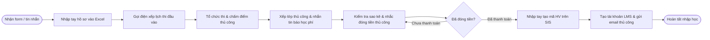

# Quy trình 02: Trường học & Trung tâm đào tạo — Tuyển sinh, Kiểm tra đầu vào & Nhập học

> **Tệp mô hình Camunda 7:**
> - **BPMN As-Is:** [as-is-student-enrollment.bpmn](./bpmn/as-is-student-enrollment.bpmn) (`Process_Enrollment_AsIs`)
> - **BPMN To-Be:** [to-be-student-enrollment.bpmn](./bpmn/to-be-student-enrollment.bpmn) (`Process_Enrollment_ToBe`)
> - **DMN Decision Table:** [class-level-placement.dmn](./dmn/class-level-placement.dmn) (`Decision_ClassPlacement`)

---

## 1. Bối cảnh nghiệp vụ (Việt Nam & Quốc tế)

- **Tại Việt Nam:** Chuyển đổi quy trình tư vấn tuyển sinh thủ công (thu thập hồ sơ qua Google Form/Zalo, lưu bảng tính Excel, gọi điện hẹn lịch kiểm tra đầu vào, đối chiếu sao kê ngân hàng bằng mắt) sang điều phối tự động kết hợp **VietQR / Virtual Account**.
- **Quốc tế:** Camunda đóng vai trò lớp điều phối (**Orchestration Layer**) kết nối Cổng tuyển sinh (Admissions Portal) với Hệ thống Quản lý Sinh viên (**SIS**) và Hệ thống Quản lý Học tập (**LMS** như Canvas / Moodle).
- **Bước nhảy số hóa:** Tự động hóa xuyên suốt từ lúc thí sinh nộp đơn đến khi được cấp mã học viên, tạo tài khoản LMS và xếp lớp mà không cần giáo vụ nhập liệu lặp lại.

---

## 2. Sơ đồ đối chiếu As-Is vs To-Be (Hiển thị trực tiếp trên GitHub)

### 2.1. Quy trình Hiện tại (As-Is) — Phụ thuộc Excel & Nhắn tin thủ công

### 2.2. Quy trình Tái thiết kế (To-Be) — Event-Based Gateway & Onboarding Sub-Process

```mermaid
flowchart LR
    EXT(["Cổng Tuyển sinh / Bank Webhook"]) -.->|"ApplicationSubmitted"| MS(["Message Start: Nhận hồ sơ"])
    MS --> ST1["Service Task: Kiểm tra hồ sơ & chống trùng lặp<br/>(topic: admission-validate-dedup)"]
    ST1 --> G1{"Hồ sơ hợp lệ?"}
    G1 -->|"docsValid == false"| ST2["Service Task: Yêu cầu bổ sung hồ sơ"] --> E1(["Chờ bổ sung"])
    G1 -->|"docsValid == true"| ST3["Service Task: Xếp lịch thi đầu vào tự động"]
    ST3 --> UT1["User Task: Thi & nhập điểm đầu vào<br/>(group: examiners)"]
    UT1 --> DMN["Business Rule Task (DMN):<br/>Decision_ClassPlacement"]
    DMN --> ST4["Service Task: Gửi báo trúng tuyển & QR học phí"]
    ST4 --> EBG{{"Event-Based Gateway<br/>(Chờ thanh toán / Quá hạn)"}}
    EBG -->|"Message: TuitionPaidWebhook"| SUB
    EBG -->|"Timer: PT72H (Quá 72 giờ)"| G2{"Đã nhắc trước đó?"}
    G2 -->|"remindedOnce == false"| REM["Service Task: Gửi email nhắc đóng học phí"] --> EBG
    G2 -->|"remindedOnce == true"| REV["Service Task: Thu hồi suất giữ chỗ"] --> E2(["Hủy giữ chỗ"])

    subgraph SUB ["Sub-Process: Nhập học Tự động (Sub_P2_Onboarding)"]
        direction LR
        SS(["Start"]) --> S1["Cấp mã HV (SIS)"] --> S2["Tạo tài khoản LMS"] --> S3["Gửi Welcome Kit"] --> SE(["End"])
    end
    SUB --> E3(["Hoàn tất nhập học"])
```

---

## 3. Luật nghiệp vụ DMN (`Decision_ClassPlacement`)

- **Hit Policy:** `FIRST` (`camunda:mapDecisionResult="singleResult"`, lưu vào biến `placementResult`)
- **Đầu vào:** `placementScore` (double), `studentAge` (integer), `preferredShift` (string)
- **Đầu ra:** `classLevel`, `tuitionFeeVND`, `assignedCohortCode`

| `placementScore` | `studentAge` | `preferredShift` | `classLevel` | `tuitionFeeVND` | `assignedCohortCode` |
| --- | --- | --- | --- | :-: | --- |
| `-` | `<= 12` | `-` | `"INTENSIVE_KIDS"` | `4,500,000` | `"KID-A1"` |
| `< 45` | `> 12` | `"EVENING"` | `"FOUNDATION"` | `5,500,000` | `"FND-EVE-01"` |
| `< 45` | `> 12` | `-` | `"FOUNDATION"` | `5,200,000` | `"FND-WKD-01"` |
| `[45..74.9]` | `> 12` | `"EVENING"` | `"INTERMEDIATE"` | `6,800,000` | `"INT-EVE-02"` |
| `[45..74.9]` | `> 12` | `-` | `"INTERMEDIATE"` | `6,500,000` | `"INT-DAY-02"` |
| `>= 75` | `> 12` | `-` | `"ADVANCED"` | `7,900,000` | `"ADV-01"` |

---

## 4. Đặc tả tích hợp Camunda 7 (Spring Boot + JavaScript)

### 4.1. Message & Timer Events
| Thành phần | ID | Cấu hình Camunda 7 |
| --- | --- | --- |
| **Message Start** | `Start_P2_App` | `Message_ApplicationSubmitted` (`ApplicationSubmitted`) — Web tuyển sinh gửi qua Spring Boot API |
| **Message Catch** | `Catch_P2_Paid` | `Message_TuitionPaidWebhook` (`TuitionPaidWebhook`) — Spring Boot Controller nhận Webhook từ ngân hàng/cổng thanh toán và gọi `runtimeService.createMessageCorrelation("TuitionPaidWebhook").processInstanceBusinessKey(orderCode).correlate()` |
| **Timer Catch** | `Catch_P2_Timer72H` | `PT72H` (72 giờ) — Tự động kích hoạt nhắc đóng học phí lần 1, sau lần 2 thì thu hồi suất giữ chỗ |

### 4.2. External Task Topics
| Topic (`camunda:topic`) | Biến đầu vào chính | Biến đầu ra kỳ vọng | Trách nhiệm |
| --- | --- | --- | --- |
| `admission-validate-dedup` | `fullName`, `phone`, `email`, `idNumber`, `attachments` | `docsValid`, `missingReasons`, `applicantId` | Kiểm tra file học bạ/ảnh và chống trùng hồ sơ |
| `notify-missing-documents` | `applicantId`, `email`, `missingReasons` | `notifiedAt` | Gửi thông báo bổ sung hồ sơ |
| `schedule-placement-test` | `applicantId`, `preferredShift` | `testSlot`, `testRoomOrLink` | Gửi lịch thi đầu vào hoặc link làm bài online |
| `send-offer-payment-qr` | `applicantId`, `placementResult` | `paymentOrderCode`, `vietQrUrl`, `remindedOnce` (`false`) | Phát hành thư trúng tuyển kèm QR/VA thanh toán |
| `send-payment-reminder` | `applicantId`, `paymentOrderCode`, `vietQrUrl` | `remindedOnce` (`true`) | Gửi email/Zalo nhắc thanh toán trước khi hủy giữ chỗ |
| `revoke-seat-reservation` | `applicantId`, `assignedCohortCode` | `seatReleased` | Giải phóng chỗ trống trong lớp |
| `sis-create-student-id` | `applicantId`, `placementResult` | `studentCode` | Tạo hồ sơ học viên chính thức trên SIS |
| `lms-provision-account` | `studentCode`, `email`, `assignedCohortCode` | `lmsUserId`, `lmsEnrolled` | Tạo tài khoản Canvas/Moodle & ghi danh khóa học |
| `send-welcome-kit` | `studentCode`, `lmsUserId`, `assignedCohortCode` | `welcomeSentAt` | Gửi tài khoản đăng nhập & thời khóa biểu |
