# Quy trình 03: Lớp học & Vận hành giảng dạy — Điểm danh, Sắp xếp Học bù & Đối soát Thù lao

> **Tệp mô hình Camunda 7:**
> - **BPMN As-Is:** [as-is-attendance-payroll.bpmn](./bpmn/as-is-attendance-payroll.bpmn) (`Process_Attendance_AsIs`)
> - **BPMN To-Be:** [to-be-attendance-payroll.bpmn](./bpmn/to-be-attendance-payroll.bpmn) (`Process_Attendance_ToBe`)
> - **DMN Decision Requirements Diagram (DRD):** [substitute-teacher-and-rate.dmn](./dmn/substitute-teacher-and-rate.dmn) (`Decision_SubstituteEligibility`, `Decision_TeachingRate`)

---

## 1. Bối cảnh nghiệp vụ (Việt Nam & Quốc tế)

- **Tại Việt Nam & Quốc tế:** Khi giáo viên báo nghỉ đột xuất hoặc học viên nghỉ có phép, bộ phận giáo vụ thường phải tra Excel tìm người dạy thay, nhắn tin từng phụ huynh để sắp lịch học bù và cuối tháng cộng tay số buổi dạy để tính lương.
- **Bước nhảy số hóa:** Biến từng sự kiện điểm danh/báo nghỉ thành kích hoạt luồng điều phối thời gian thực: tự động lọc giáo viên dạy thay qua DMN, sinh vòng lặp đa thực thể (**Multi-Instance Sub-Process**) theo dõi học bù cho từng học viên vắng có phép, tính đơn giá thù lao tự động và khóa sổ lương sau 48h nếu không có khiếu nại.

---

## 2. Sơ đồ đối chiếu As-Is vs To-Be (Hiển thị trực tiếp trên GitHub)

### 2.1. Quy trình Hiện tại (As-Is) — Thủ công rời rạc

### 2.2. Quy trình Tái thiết kế (To-Be) — Multi-Instance Sub-Process & Timer Auto-Lock

```mermaid
flowchart LR
    S(["Khởi tạo phiên buổi học"]) --> EBG{{"Event-Based Gateway"}}
    EBG -->|"Message: TeacherLeaveRequested"| DMN1["DMN: Decision_SubstituteEligibility<br/>Lọc GV dạy thay phù hợp"]
    DMN1 --> UT1["User Task: Giáo vụ xác nhận GV thay<br/>(group: academic_ops)"]
    UT1 --> MC2(["Message Catch: AttendanceCompleted"])
    EBG -->|"Message: AttendanceCompleted"| MC2

    MC2 --> PG1{{"Parallel Gateway (Fork)"}}
    PG1 --> G_ABS{"Có HV vắng có phép?"}
    G_ABS -->|"absentStudents.size() > 0"| SUB
    G_ABS -->|"absentStudents.size() == 0"| PG2{{"Parallel Gateway (Join)"}}

    subgraph SUB ["Multi-Instance Sub-Process (collection: absentStudents)"]
        direction LR
        SS(["Start"]) --> S1["Gửi phụ huynh slot học bù"] --> S2(["Catch: MakeupSlotSelected"]) --> S3["Theo dõi hoàn thành bù"] --> SE(["End"])
    end
    SUB --> PG2

    PG1 --> DMN2["DMN: Decision_TeachingRate<br/>Tính đơn giá thù lao buổi dạy"]
    DMN2 --> LED["Service Task: Ghi sổ công lương<br/>(topic: record-session-payroll)"]
    LED --> PG2

    PG2 --> UT2["User Task: GV kiểm tra phiếu lương<br/>(assignee: teacherId)"]
    UT2 -->|"Hoàn tất"| G_DIS{"Có khiếu nại?"}
    UT2 -.->|"Timer Boundary: PT48H"| LOCK["Service Task: Khóa sổ lương & chờ giải ngân"]
    G_DIS -->|"disputed == false"| LOCK
    G_DIS -->|"disputed == true"| UT3["User Task: Kế toán đối soát sai lệch<br/>(group: payroll_admins)"] --> LOCK
    LOCK --> END(["Hoàn tất đối soát & chi trả"])
```

---

## 3. Luật nghiệp vụ DMN (`substitute-teacher-and-rate.dmn`)

File DMN thiết kế theo chuẩn **DRD (2 bảng quyết định trong 1 file)**:

### 3.1. `Decision_SubstituteEligibility` (`hitPolicy="COLLECT"`, `mapDecisionResult="resultList"`)
Lọc danh sách nhóm giáo viên dạy thay thỏa mãn chuyên môn và không trùng lịch:

| `requiredSubject` | `classLevel` | `hasScheduleConflict` | `substitutePoolGroup` | `invitePriority` |
| --- | --- | :-: | --- | :-: |
| `"ENGLISH_IELTS"` | `"ADVANCED"` | `false` | `"SENIOR_IELTS_MENTORS"` | `1` |
| `"ENGLISH_IELTS"` | `-` | `false` | `"GENERAL_ENGLISH_TEACHERS"` | `2` |
| `"STEM_CODING"` | `-` | `false` | `"STEM_INSTRUCTORS"` | `1` |
| `-` | `-` | `true` | `"NONE_AVAILABLE"` | `99` |

### 3.2. `Decision_TeachingRate` (`hitPolicy="FIRST"`, `mapDecisionResult="singleResult"`)
Tính đơn giá thù lao theo thâm niên (`teacherTenureMonths`), ca dạy (`sessionShift`) và sĩ số thực tế (`actualAttendanceCount`):

| `teacherTenureMonths` | `sessionShift` | `actualAttendanceCount` | `baseRateVND` | `bonusVND` |
| --- | --- | --- | :-: | :-: |
| `>= 24` | `"EVENING"` | `>= 15` | `450,000` | `100,000` |
| `>= 24` | `-` | `-` | `450,000` | `50,000` |
| `[12..23]` | `"WEEKEND"` | `>= 12` | `360,000` | `80,000` |
| `[12..23]` | `-` | `-` | `360,000` | `0` |
| `< 12` | `-` | `-` | `280,000` | `0` |

---

## 4. Đặc tả tích hợp Camunda 7 (Spring Boot + JavaScript)

### 4.1. Message & Timer Events
| Thành phần | ID | Cấu hình Camunda 7 |
| --- | --- | --- |
| **Message Catch (Báo nghỉ)** | `Catch_P3_Leave` | `Message_TeacherLeave` (`TeacherLeaveRequested`) |
| **Message Catch (Điểm danh)** | `Catch_P3_Attend` | `Message_AttendanceDone` (`AttendanceCompleted`) — truyền biến `absentStudents` (List các học viên vắng có phép) và `actualAttendanceCount` |
| **Message Catch (Chọn lịch bù)** | `Catch_P3_SlotPicked` | `Message_MakeupSlotPicked` (`MakeupSlotSelected`) — correlate theo `student.studentId` + `sessionId` |
| **Timer Boundary (Auto-Lock)** | `BE_P3_Timer48H` | `cancelActivity="true"`, `PT48H` — tự động hủy User Task chờ xác nhận của GV và khóa sổ lương sau 48 giờ |

### 4.2. External Task Topics
| Topic (`camunda:topic`) | Biến đầu vào chính | Biến đầu ra kỳ vọng | Trách nhiệm |
| --- | --- | --- | --- |
| `send-parent-makeup-slots` | `student`, `classLevel`, `sessionId` | `availableMakeupSlots` | Tìm phòng/ca trống phù hợp và gửi tin nhắn cho phụ huynh |
| `track-makeup-completion` | `student`, `selectedMakeupSlotId` | `makeupCompleted` | Ghi nhận lịch bù lên SIS và xác nhận học viên đã học bù |
| `record-session-payroll` | `teacherId`, `sessionId`, `rateResult` | `payrollEntryId`, `sessionTotalVND` | Ghi nhận công buổi dạy vào sổ lương thời gian thực |
| `payroll-lock-and-disburse` | `teacherId`, `payrollPeriod` | `payrollLockedAt`, `disbursementBatchId` | Chốt bảng công kỳ lương và chuyển bộ phận tài chính giải ngân |
