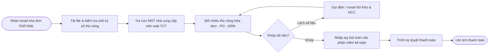

# Quy trình 04: Kế toán & Mua sắm — Xử lý Hóa đơn Đầu vào & Đối chiếu 3 bên

> **Tệp mô hình Camunda 7:**
> - **BPMN As-Is:** [as-is-invoice-matching.bpmn](./bpmn/as-is-invoice-matching.bpmn) (`Process_Invoice_AsIs`)
> - **BPMN To-Be:** [to-be-invoice-matching.bpmn](./bpmn/to-be-invoice-matching.bpmn) (`Process_Invoice_ToBe`)
> - **DMN Decision Table:** [invoice-matching-tolerance.dmn](./dmn/invoice-matching-tolerance.dmn) (`Decision_InvoiceTolerance`)

---

## 1. Bối cảnh nghiệp vụ (Việt Nam & Quốc tế)

- **Tại Việt Nam:** Doanh nghiệp nhận hóa đơn điện tử định dạng **XML/PDF** theo chuẩn Tổng cục Thuế (Nghị định 123 / Thông tư 78) qua email kế toán. Trước đây kế toán phải tải file, kiểm tra chữ ký số thủ công, tra cứu mã số thuế (MST) nhà cung cấp rồi đối chiếu tay với Đơn đặt hàng (**PO**) và Phiếu nhập kho (**GRN**).
- **Quốc tế:** Tương đương quy trình **AP Automation / 3-Way Matching** áp dụng cho hóa đơn chuẩn **Peppol / EDI** hoặc trích xuất **OCR** từ PDF.
- **Bước nhảy số hóa (Straight-Through Processing — STP):** Hóa đơn khớp dữ liệu 100% (hoặc nằm trong ngưỡng làm tròn cho phép bởi DMN) đi thẳng tới bước hạch toán và lên lịch thanh toán mà không cần con người chạm vào; chỉ ngoại lệ mới tạo `UserTask` cho kế toán.

---

## 2. Sơ đồ đối chiếu As-Is vs To-Be (Hiển thị trực tiếp trên GitHub)

### 2.1. Quy trình Hiện tại (As-Is) — Nhập liệu & Đối chiếu thủ công

### 2.2. Quy trình Tái thiết kế (To-Be) — Straight-Through Processing (STP)

```mermaid
flowchart LR
    EXT(["Email NCC / Cổng Thuế / ERP"]) -.->|"InvoiceEmailReceived"| MS(["Message Start: Nhận email hóa đơn"])
    MS --> G1{"Định dạng file?"}
    G1 -->|"fileType == 'XML'"| XML["Service Task: Bóc tách XML & verify chữ ký số<br/>(topic: invoice-xml-parser)"]
    G1 -->|"fileType == 'PDF'"| OCR["Service Task: Trích xuất dữ liệu OCR<br/>(topic: invoice-ocr-extractor)"]
    XML --> G2(( ))
    OCR --> G2
    G2 --> TAX["Service Task: API kiểm tra MST nhà cung cấp<br/>(topic: tax-mst-verification)"]
    TAX --> ERP["Service Task: Truy vấn PO & GRN từ ERP<br/>(topic: erp-fetch-po-grn)"]
    ERP --> DMN["Business Rule Task (DMN):<br/>Decision_InvoiceTolerance"]
    DMN --> G3{"Khớp 3 bên (STP)?"}
    G3 -->|"allowStp == true (STP)"| PAY["Service Task: Hạch toán & lên lịch thanh toán ERP<br/>(topic: erp-schedule-payment)"]
    G3 -->|"allowStp == false"| UT["User Task: Kế toán xử lý sai lệch<br/>(group: ap_accountants)"]
    UT --> G4{"Chấp nhận thanh toán?"}
    G4 -->|"exceptionApproved == true"| PAY
    G4 -->|"exceptionApproved == false"| REJ["Service Task: Từ chối hóa đơn cho NCC<br/>(topic: notify-vendor-reject-invoice)"] --> E_REJ(["Hóa đơn bị từ chối"])
    PAY --> E_OK(["Hoàn tất xử lý hóa đơn"])
```

---

## 3. Luật nghiệp vụ DMN (`Decision_InvoiceTolerance`)

- **Hit Policy:** `FIRST` (`camunda:mapDecisionResult="singleResult"`, lưu vào biến `matchDecision`)
- **Đầu vào:** `grnStatus` (`"COMPLETED"`, `"PARTIAL"`, `"MISSING"`), `qtyVariance` (integer), `priceVariancePercent` (double), `invoiceTotalVND` (long)
- **Đầu ra:** `matchingResult`, `allowStp` (boolean), `exceptionReason`

| `grnStatus` | `qtyVariance` | `priceVariancePercent` | `invoiceTotalVND` | `matchingResult` | `allowStp` | `exceptionReason` |
| --- | :-: | :-: | :-: | --- | :-: | --- |
| `"MISSING"` | `-` | `-` | `-` | `"MANUAL_EXCEPTION"` | `false` | `"Chưa có Phiếu nhập kho (GRN)"` |
| `"PARTIAL"` | `-` | `-` | `-` | `"MANUAL_EXCEPTION"` | `false` | `"Mới nhập kho một phần"` |
| `"COMPLETED"` | `!= 0` | `-` | `-` | `"MANUAL_EXCEPTION"` | `false` | `"Sai lệch số lượng so với PO/GRN"` |
| `"COMPLETED"` | `0` | `0` | `-` | `"AUTO_MATCH"` | `true` | `"Khớp 100% PO - GRN - Hóa đơn"` |
| `"COMPLETED"` | `0` | `[0.01..0.5]` | `<= 50,000,000` | `"MINOR_VARIANCE_APPROVED"` | `true` | `"Sai số làm tròn trong ngưỡng <= 0.5%"` |
| `-` | `-` | `-` | `-` | `"MANUAL_EXCEPTION"` | `false` | `"Vượt ngưỡng sai số hoặc giá trị lớn"` |

---

## 4. Đặc tả tích hợp Camunda 7 (Spring Boot + JavaScript)

### 4.1. Message Start Event
- `Start_P4_Email`: `Message_InvoiceEmail` (`InvoiceEmailReceived`) — Email Poller / Webhook (Spring Boot Integration hoặc Node.js IMAP listener) đẩy metadata + attachment URL vào Camunda REST API kèm biến `fileType` (`"XML"` hoặc `"PDF"`).

### 4.2. External Task Topics
| Topic (`camunda:topic`) | Biến đầu vào chính | Biến đầu ra kỳ vọng | Trách nhiệm |
| --- | --- | --- | --- |
| `invoice-xml-parser` | `attachmentUrl` | `invoiceNumber`, `vendorTaxCode`, `poNumber`, `invoiceItems`, `invoiceTotalVND`, `signatureValid` | Bóc tách XML hóa đơn điện tử TCT và kiểm tra chữ ký số |
| `invoice-ocr-extractor` | `attachmentUrl` | `invoiceNumber`, `vendorTaxCode`, `poNumber`, `invoiceItems`, `invoiceTotalVND` | Gọi OCR service trích xuất trường dữ liệu từ PDF |
| `tax-mst-verification` | `vendorTaxCode` | `taxStatusActive`, `vendorLegalName` | Kiểm tra MST nhà cung cấp đang hoạt động |
| `erp-fetch-po-grn` | `poNumber`, `invoiceItems`, `invoiceTotalVND` | `grnStatus`, `qtyVariance`, `priceVariancePercent` | Đối chiếu dữ liệu PO và GRN trên ERP để tính sai lệch |
| `erp-schedule-payment` | `invoiceNumber`, `poNumber`, `invoiceTotalVND` | `erpVoucherId`, `scheduledPayDate` | Tạo bút toán công nợ (AP) và lên lịch thanh toán |
| `notify-vendor-reject-invoice` | `vendorEmail`, `invoiceNumber`, `rejectionReason` | `notifiedAt` | Thông báo nhà cung cấp xuất hóa đơn điều chỉnh/thay thế |
