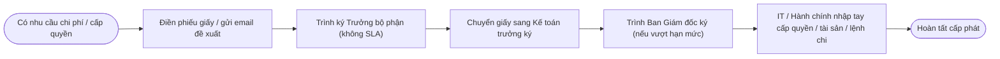
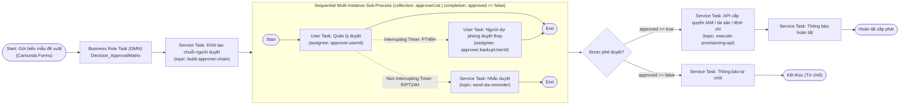

# Quy trình 05: Quản trị nội bộ — Phê duyệt Đa cấp & Cấp phát Tài nguyên Tự động

> **Tệp mô hình Camunda 7:**
> - **BPMN As-Is:** [as-is-multilevel-approval.bpmn](./bpmn/as-is-multilevel-approval.bpmn) (`Process_Approval_AsIs`)
> - **BPMN To-Be:** [to-be-multilevel-approval.bpmn](./bpmn/to-be-multilevel-approval.bpmn) (`Process_Approval_ToBe`)
> - **DMN Decision Table:** [approval-routing-matrix.dmn](./dmn/approval-routing-matrix.dmn) (`Decision_ApprovalMatrix`)

---

## 1. Bối cảnh nghiệp vụ (Việt Nam & Quốc tế)

- **Tại Việt Nam:** Các bệnh viện, trường học và doanh nghiệp có cơ chế phân quyền duyệt chi phí, mua sắm thiết bị hoặc cấp quyền truy cập hệ thống chặt chẽ theo hạn mức tài chính và chức danh (Trưởng bộ phận $\rightarrow$ Kế toán trưởng $\rightarrow$ Ban Giám đốc). Khi trình ký giấy hoặc email rời rạc, hồ sơ rất dễ bị "ngâm" không có cơ chế nhắc nhở hay leo thang.
- **Quốc tế:** Tương đương quy trình **Service Request & Access Provisioning** kết nối trực tiếp với hệ thống quản trị định danh (**IAM / Active Directory**), quản lý tài sản và cổng ngân hàng doanh nghiệp.
- **Bước nhảy số hóa:** Tách rời ma trận phân quyền duyệt ra khỏi code bằng **DMN**, sử dụng **Sequential Multi-Instance Sub-Process** cho từng cấp duyệt với cặp **Non-Interrupting Timer (24h nhắc định kỳ)** + **Interrupting Timer (48h leo thang sang người dự phòng)**, và tự động gọi API cấp phát ngay sau khi duyệt xong.

---

## 2. Sơ đồ đối chiếu As-Is vs To-Be (Hiển thị trực tiếp trên GitHub)

### 2.1. Quy trình Hiện tại (As-Is) — Trình ký giấy & Dễ ngâm hồ sơ

### 2.2. Quy trình Tái thiết kế (To-Be) — DMN Routing + SLA Escalation + Auto Provisioning

> **Ghi chú kiến trúc Camunda 7:** Việc đặt cặp Timer Boundary Events bên trong `Sub_P5_TierApproval` (thay vì gắn trực tiếp lên một User Task đa thực thể) đảm bảo khi **một cấp duyệt** bị quá hạn 48h, **Interrupting Timer** chỉ hủy bước của người quản lý đang trễ để chuyển cho `backupUserId`, không làm hủy toàn bộ chuỗi phê duyệt đa cấp.

---

## 3. Luật nghiệp vụ DMN (`Decision_ApprovalMatrix`)

- **Hit Policy:** `FIRST` (`camunda:mapDecisionResult="singleResult"`, lưu vào biến `approvalPolicy`)
- **Đầu vào:** `requestType` (`"EXPENSE"`, `"PROCUREMENT"`, `"IT_ACCESS"`), `amountVND` (long), `department` (string)
- **Đầu ra:** `approvalTier`, `requireDepartmentHead`, `requireChiefAccountant`, `requireBoardDirector`, `slaHours`

| `requestType` | `amountVND` | `department` | `approvalTier` | TBP | KTT | BGĐ | `slaHours` |
| --- | --- | --- | :-: | :-: | :-: | :-: | :-: |
| `"IT_ACCESS"` | `-` | `"SECURITY"` | `2` | `true` | `false` | `true` | `24` |
| `"IT_ACCESS"` | `-` | `-` | `1` | `true` | `false` | `false` | `24` |
| `-` | `< 5,000,000` | `-` | `1` | `true` | `false` | `false` | `48` |
| `-` | `[5,000,000..50,000,000]` | `-` | `2` | `true` | `true` | `false` | `48` |
| `-` | `> 50,000,000` | `-` | `3` | `true` | `true` | `true` | `48` |

---

## 4. Đặc tả tích hợp Camunda 7 (Spring Boot + JavaScript)

### 4.1. Multi-Instance & Timer Boundary Events
| Thành phần | ID | Cấu hình Camunda 7 |
| --- | --- | --- |
| **Sequential Multi-Instance** | `Sub_P5_TierApproval` | `isSequential="true"`, `camunda:collection="${approverList}"`, `camunda:elementVariable="approver"`, `completionCondition="${approved == false}"` |
| **Non-Interrupting Timer** | `BE_P5_Remind24H` | `cancelActivity="false"`, `timeCycle="R/PT24H"` — gửi thông báo nhắc duyệt định kỳ mỗi 24h mà không đóng User Task |
| **Interrupting Timer** | `BE_P5_Escalate48H` | `cancelActivity="true"`, `timeDuration="PT48H"` — sau 48h tự động leo thang chuyển quyền duyệt cho `approver.backupUserId` |

### 4.2. External Task Topics
| Topic (`camunda:topic`) | Biến đầu vào chính | Biến đầu ra kỳ vọng | Trách nhiệm |
| --- | --- | --- | --- |
| `build-approver-chain` | `requesterId`, `department`, `approvalPolicy` | `approverList` (Array `{userId, backupUserId, role}`), `approved` (`true`) | Truy vấn sơ đồ tổ chức (Org Chart) để dựng danh sách người duyệt & người dự phòng |
| `send-sla-reminder` | `approver`, `requestId`, `requestTitle` | `lastRemindedAt` | Gửi thông báo nhắc duyệt qua Email / Slack / MS Teams / Zalo OA |
| `execute-provisioning-api` | `requestType`, `requestPayload`, `approverList` | `provisioningRefId`, `provisionedAt` | Gọi API cấp quyền IAM/AD, tạo mã tài sản cố định hoặc đẩy lệnh chi ngân hàng |
| `notify-request-completed` | `requesterId`, `provisioningRefId` | `completedNotifiedAt` | Thông báo kết quả cấp phát cho nhân viên đề xuất |
| `notify-request-rejected` | `requesterId`, `rejectionComment` | `rejectedNotifiedAt` | Thông báo lý do từ chối từ cấp duyệt |
