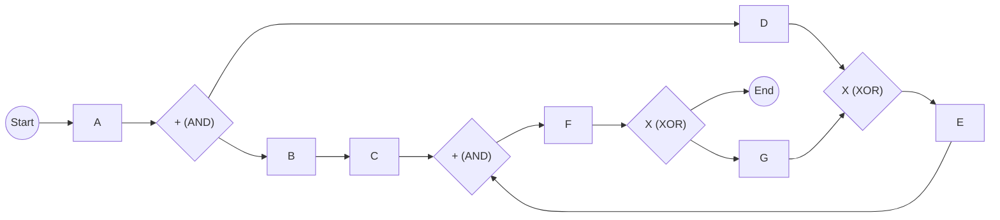
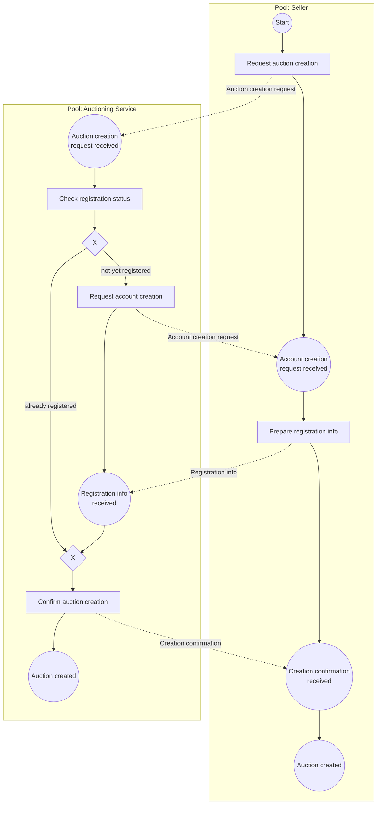
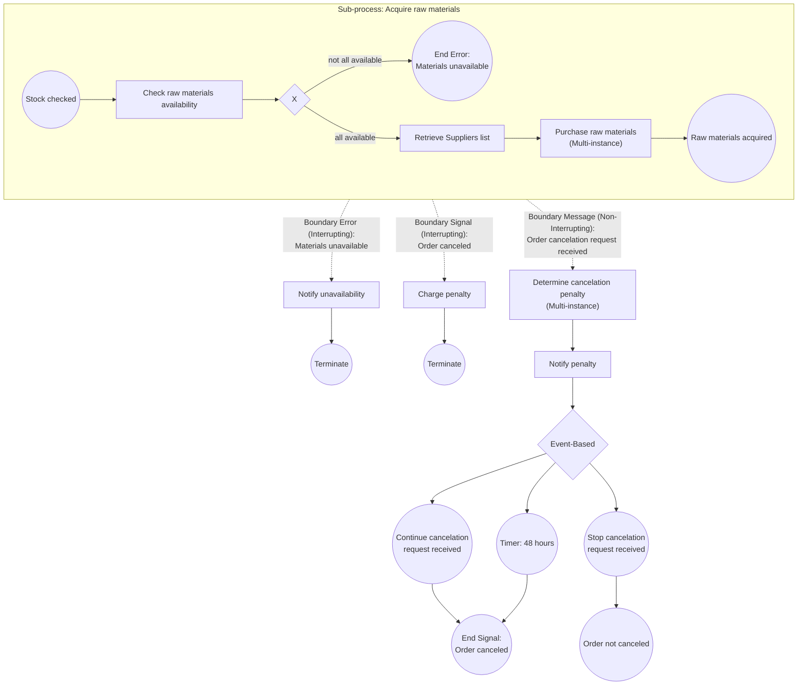

# 📝 Ngân Hàng 29 Câu Quiz & Giải Thích Chi Tiết (Chế độ Tự Kiểm Tra)

> Tổng hợp đầy đủ **Quiz 1 (6 câu), Quiz 3 (8 câu), Quiz 4 (6 câu), Quiz 5 (4 câu), Quiz 6 (5 câu)** từ [`Document/ref/Quiz và đáp án/`](./ref/Quiz%20v%C3%A0%20%C4%91%C3%A1p%20%C3%A1n/).  
> **Cách học hiệu quả:** Đọc câu hỏi, tự chọn đáp án trước, sau đó bấm **`Xem đáp án & Giải thích`** để kiểm tra ngay trên GitHub!  
> *(Bạn cũng có thể tra cứu/lọc nhanh dạng bảng tại [quiz-bank.csv](./quiz-bank.csv)).*  
> [⬅️ Quay lại Trang chủ Ôn thi](./README.md)

---

## Phần 1: Quiz 1 — Introduction to BPM (Lecture 1 — 6 câu)

> 📖 **Lý thuyết liên quan:** [Lecture 1: Giới thiệu BPM](./01-Ly-Thuyet-Tong-Hop.md#lecture-1-giới-thiệu-bpm-introduction) • [Lecture 2: Xác định Quy trình](./01-Ly-Thuyet-Tong-Hop.md#lecture-2-xác-định-quy-trình-process-identification) • [Slide Lecture 1](./ref/Slide/Lecture1-Introduction.pdf)

### Q1.1 — Phân biệt Task và Condition
**Which of the following is NOT a task?** *(Điều nào sau đây KHÔNG phải là một tác vụ / task?)*
- a) Check insurance policy details *(Kiểm tra chi tiết hợp đồng bảo hiểm)*
- b) Insurance policy does not cover the damage *(Hợp đồng bảo hiểm không bao gồm thiệt hại)*
- c) Calculate settlement amount *(Tính toán số tiền bồi thường)*
- d) Determine if customer is liable for damage *(Xác định khách hàng có chịu trách nhiệm về thiệt hại hay không)*

✅ Xem đáp án & Giải thích

- **Đáp án đúng:** **b) Insurance policy does not cover the damage**
- **Giải thích:** Đây là một **điều kiện (condition)** đúng/sai gắn ở nhánh rẽ quyết định (XOR-split), không phải hành động thực thi. Các đáp án còn lại đều bắt đầu bằng động từ chủ động (*Check, Calculate, Determine*).
- **📚 Tham chiếu lý thuyết:** [1.1. Quy trình nghiệp vụ là gì?](./01-Ly-Thuyet-Tong-Hop.md#11-quy-trình-nghiệp-vụ-business-process-là-gì) • [3.1. 4 Phần tử lõi & Quy ước đặt tên](./01-Ly-Thuyet-Tong-Hop.md#31-4-phần-tử-lõi--quy-ước-đặt-tên)

---

### Q1.2 — Phân biệt Event và Task
**Which of the following is NOT an event?** *(Điều nào sau đây KHÔNG phải là một sự kiện / event?)*
- a) Purchase order received *(Đơn đặt hàng đã được nhận)*
- b) Claim withdrawn by customer *(Khiếu nại đã được khách hàng rút lại)*
- c) Notify settlement decision to customer *(Thông báo quyết định giải quyết cho khách hàng)*
- d) Payment delay expired *(Thời hạn chậm thanh toán đã hết)*

✅ Xem đáp án & Giải thích

- **Đáp án đúng:** **c) Notify settlement decision to customer**
- **Giải thích:** Bắt đầu bằng động từ chủ động ("Notify") và cần người thực hiện → đây là **Task**, không phải Event. Event có dạng **Danh từ + Phân từ quá khứ** (*received, withdrawn, expired*).
- **📚 Tham chiếu lý thuyết:** [1.1. Quy trình nghiệp vụ là gì?](./01-Ly-Thuyet-Tong-Hop.md#11-quy-trình-nghiệp-vụ-business-process-là-gì) • [3.1. 4 Phần tử lõi & Quy ước đặt tên](./01-Ly-Thuyet-Tong-Hop.md#31-4-phần-tử-lõi--quy-ước-đặt-tên)

---

### Q1.3 — Phân biệt Core Process và Function
**Which of the following statements refer to a critical (core) process of a company?** *(Mục nào sau đây đề cập đến một quy trình cốt lõi của công ty?)*
- a) Human resource management *(Quản lý nguồn nhân lực)*
- b) Accounts payable *(Kế toán phải trả)*
- c) Order-to-cash *(Đặt hàng đến thu tiền)*
- d) Customer relationship management *(Quản lý quan hệ khách hàng)*

✅ Xem đáp án & Giải thích

- **Đáp án đúng:** **c) Order-to-cash**
- **Giải thích:** `Order-to-cash` là **quy trình cốt lõi** xuất hiện ở hầu hết doanh nghiệp tư nhân. HRM, CRM và Accounts Payable là các **chức năng / phòng ban (functions)**, không phải quy trình end-to-end.
- **📚 Tham chiếu lý thuyết:** [1.1. Quy trình nghiệp vụ — Phân biệt Process vs Function](./01-Ly-Thuyet-Tong-Hop.md#11-quy-trình-nghiệp-vụ-business-process-là-gì) • [2.1. Phân loại 3 nhóm quy trình](./01-Ly-Thuyet-Tong-Hop.md#21-phân-loại-3-nhóm-quy-trình-michael-porter-1985)

---

### Q1.4 — Xác định Core Processes của công ty cấp nước *(Chọn nhiều đáp án)*
**A water utility company provides drinking water to residents and businesses, as well as wastewater treatment services. Which processes are likely to be core processes of this company?**
- [ ] Bill-to-cash *(Xuất hóa đơn → Thu tiền)*
- [ ] Procure-to-pay *(Mua sắm → Thanh toán)*
- [ ] Issue-to-resolution *(Xử lý sự cố cấp nước)*
- [ ] Infrastructure inspection *(Kiểm tra cơ sở hạ tầng ống nước)*
- [ ] Debt collection *(Thu hồi nợ)*

✅ Xem đáp án & Giải thích

- **Đáp án đúng:** **Bill-to-cash + Issue-to-resolution + Infrastructure inspection**
- **Giải thích:**
  - `Bill-to-cash`: Đảm bảo dòng tiền trực tiếp từ khách hàng.
  - `Issue-to-resolution`: Sự cố nước ảnh hưởng trực tiếp tới khách hàng, uy tín và pháp lý.
  - `Infrastructure inspection`: Hạ tầng đường ống là tài sản cốt lõi của công ty cấp nước.
  - `Procure-to-pay` là quy trình hỗ trợ; `Debt collection` có thể thuê ngoài (outsource) nên không phải core.
- **📚 Tham chiếu lý thuyết:** [2.1. Phân loại 3 nhóm quy trình (Core / Support / Management)](./01-Ly-Thuyet-Tong-Hop.md#21-phân-loại-3-nhóm-quy-trình-michael-porter-1985) • [1.1. Quy trình nghiệp vụ là gì?](./01-Ly-Thuyet-Tong-Hop.md#11-quy-trình-nghiệp-vụ-business-process-là-gì)

---

### Q1.5 — Thước đo hiệu suất liên quan trực tiếp đến Chi phí *(Chọn nhiều đáp án)*
**In a measurement-to-cash process of an electricity company, which of the following performance measures are directly related to costs?**
- [ ] Average electricity consumption per customer *(Mức tiêu thụ điện trung bình/khách)*
- [ ] Cycle time *(Thời gian chu kỳ)*
- [ ] Percentage of under-billing errors *(Tỷ lệ lỗi tính thiếu hóa đơn)*
- [ ] Percentage of over-billing errors *(Tỷ lệ lỗi tính thừa hóa đơn)*
- [ ] Price per kilowatt-hour (KWh) *(Giá mỗi KWh)*

✅ Xem đáp án & Giải thích

- **Đáp án đúng:** **Cycle time + Percentage of under-billing errors + Percentage of over-billing errors**
- **Giải thích:**
  - `Cycle time` kéo dài → thu tiền chậm → mất chi phí lãi suất/vốn lưu động.
  - `Under-billing` → thất thoát doanh thu trực tiếp.
  - `Over-billing` → phát sinh khiếu nại từ khách hàng → tốn chi phí xử lý khiếu nại & làm lại.
  - Mức tiêu thụ điện và giá KWh không phải thước đo chi phí hiệu suất quy trình.
- **📚 Tham chiếu lý thuyết:** [1.2. Quản lý Quy trình Nghiệp vụ (BPM) & 3 Chiều Hiệu suất](./01-Ly-Thuyet-Tong-Hop.md#12-quản-lý-quy-trình-nghiệp-vụ-bpm--3-chiều-hiệu-suất)

---

### Q1.6 — Trách nhiệm giải trình trực tiếp (Accountability)
**In a process-oriented organization, who is directly accountable for poor performance of a process?** *(Ai chịu trách nhiệm trực tiếp khi quy trình hoạt động kém?)*
- a) The process participants
- b) The executive management team
- c) The process owner
- d) The process analyst
- e) The BPM group

✅ Xem đáp án & Giải thích

- **Đáp án đúng:** **c) The process owner** *(Chủ sở hữu quy trình)*
- **Giải thích:** Ban lãnh đạo ủy quyền trách nhiệm giải trình trực tiếp cho người quản lý gần quy trình nhất là **Process Owner**. Participants chỉ chia sẻ trách nhiệm thực thi; Process Analyst và BPM Group chỉ đóng vai trò hỗ trợ.
- **📚 Tham chiếu lý thuyết:** [1.3. Các vai trò trong tổ chức định hướng quy trình](./01-Ly-Thuyet-Tong-Hop.md#13-các-vai-trò-trong-tổ-chức-định-hướng-quy-trình)

---

## Phần 2: Quiz 3 — Essential Process Modeling in BPMN (Lecture 3 — 8 câu)

> 📖 **Lý thuyết liên quan:** [Lecture 3: Mô hình hóa BPMN Cơ bản](./01-Ly-Thuyet-Tong-Hop.md#lecture-3-mô-hình-hóa-bpmn-cơ-bản-process-modeling-1) • [Slide Lecture 3](./ref/Slide/Lecture3-ProcessModeling1.pdf)

### Q3.1 — Implicit Split Gateway
**If a task has two output arcs (flows), it is the same as if the task was followed by an:**
- a) XOR-split | b) XOR-join | c) AND-split | d) AND-join | e) OR-split | f) OR-join

✅ Xem đáp án & Giải thích

- **Đáp án đúng:** **c) AND-split**
- **Giải thích:** Theo quy tắc Implicit Gateway của BPMN, một Task có 2 cung đi ra trực tiếp sẽ kích hoạt đồng thời cả 2 nhánh ⟺ **AND-split**.
- **📚 Tham chiếu lý thuyết:** [3.2. Token Game & 3 loại Gateway cơ bản (Implicit vs Explicit Gateways)](./01-Ly-Thuyet-Tong-Hop.md#32-token-game--3-loại-gateway-cơ-bản)

---

### Q3.2 — Implicit Join Gateway
**If a task has two input arcs, it is the same as if the task was preceded by an:**
- a) XOR-split | b) XOR-join | c) AND-split | d) AND-join | e) OR-split | f) OR-join

✅ Xem đáp án & Giải thích

- **Đáp án đúng:** **b) XOR-join**
- **Giải thích:** Một Task có 2 cung đi vào trực tiếp sẽ được kích hoạt mỗi khi bất kỳ cung nào có token đến ⟺ **XOR-join**.
- **📚 Tham chiếu lý thuyết:** [3.2. Token Game & 3 loại Gateway cơ bản (Implicit vs Explicit Gateways)](./01-Ly-Thuyet-Tong-Hop.md#32-token-game--3-loại-gateway-cơ-bản)

---

### Q3.3 — Cổng đẩy mọi token đi qua
**Which type of gateway moves each token it receives in one of its input arcs to its output arc?**
- a) XOR-split | b) XOR-join | c) AND-split | d) AND-join | e) OR-split | f) OR-join

✅ Xem đáp án & Giải thích

- **Đáp án đúng:** **b) XOR-join**
- **Giải thích:** `XOR-join` là cổng "ngây thơ" (*dumb gateway*): không chờ đồng bộ, cứ nhận token từ bất kỳ cung vào nào là chuyển thẳng ra cung ra (nếu 2 cung vào cùng gửi 1 token, nó sẽ đẩy ra 2 token).
- **📚 Tham chiếu lý thuyết:** [3.2. Token Game & 3 loại Gateway cơ bản (XOR-join)](./01-Ly-Thuyet-Tong-Hop.md#32-token-game--3-loại-gateway-cơ-bản)

---

### Q3.4 — Tìm cổng sai trong sơ đồ BPMN (Vòng lặp trong nhánh song song)
**The following BPMN diagram contains an incorrect gateway. Which one?**

- a) The AND gateway following task A
- b) The XOR gateway following task D
- c) The AND gateway preceding task F
- d) The XOR gateway following task F

✅ Xem đáp án & Giải thích

- **Đáp án đúng:** **c) The AND gateway preceding task F**
- **Giải thích:** Sau `F`, nếu đi theo vòng lặp `G → XOR (sau D) → E`, thì chỉ có nhánh dưới (`E`) gửi token vào cổng trước `F`, trong khi nhánh trên (`B → C`) không chạy lại → `AND-join` sẽ bị **Deadlock** (chờ mãi token từ C). Do đó cổng trước F phải đổi thành **OR-join**.
- **📚 Tham chiếu lý thuyết:** [3.2. Token Game & 3 loại Gateway cơ bản (Deadlock & Rework Loop)](./01-Ly-Thuyet-Tong-Hop.md#32-token-game--3-loại-gateway-cơ-bản)

---

### Q3.5 — Tìm 2 cổng sai trong sơ đồ tiếp nhận bệnh nhân *(Chọn nhiều đáp án)*
**The following BPMN diagram contains two incorrect gateways. Which ones?**

```mermaid
flowchart LR
    P1["Store and print notice"] --> X1{"X (XOR)"}
    X1 -->|"unknown"| T1["Create patient file"] --> X2["Skip"]
    X1 -->|"known"| X2
    X2 --> A1{"+ (AND-split)"}
    A1 --> U1["Update file"] --> X3{"X (XOR)"}
    A1 --> U2["Produce cards"] --> X3
    A1 --> L1["List new case"] --> T2["Assign intakers"] --> T3["Store assignment"] --> X3
    X3 --> H["Hand out cards"] --> A2{"+ (AND-split)"}
    A2 --> M1["Plan meeting 1st intaker"] --> C1["Complete file 1st"] --> A4{"+ (AND-join)"}
    A2 --> X4{"X (XOR)"}
    X4 -->|"file not req"| A3{"+ (AND-join)"}
    X4 -->|"file req"| ASK["Ask and receive medical file"] --> A3
    A3 --> M2["Plan meeting 2nd intaker"] --> C2["Complete file 2nd"] --> A4
    A4 --> WM2(("Wednesday morning 2")) --> DT["Determine treatment"]
```

- [ ] The XOR gateway after task "Store and print notice"
- [ ] The XOR gateway preceding task "Hand out cards"
- [ ] The AND gateway preceding event "Wednesday morning 2"
- [ ] The AND gateway before task "Plan meeting second intaker"
- [ ] The AND split after task "Hand out cards"

✅ Xem đáp án & Giải thích

- **Đáp án đúng:** **The XOR gateway preceding task "Hand out cards" + The AND gateway before task "Plan meeting second intaker"**
- **Giải thích:**
  1. **Cổng XOR trước `Hand out cards`:** Trước đó 3 nhánh được tách bằng `AND-split`, nên gộp lại phải dùng **AND-join** (nếu dùng XOR-join sẽ phát thẻ 3 lần!).
  2. **Cổng AND trước `Plan meeting second intaker`:** Nhận vào 1 nhánh từ `AND-split` và 2 nhánh loại trừ từ `XOR-split` (có cần hồ sơ y tế hay không) → không bao giờ có đủ cả 3 token nên sẽ bị **Deadlock**! Phải đổi thành **OR-join** hoặc thêm một `XOR-join` gộp 2 nhánh hồ sơ y tế trước khi vào `AND-join`.
- **📚 Tham chiếu lý thuyết:** [3.2. Token Game & 3 loại Gateway cơ bản (Deadlock / Lack of Synchronization)](./01-Ly-Thuyet-Tong-Hop.md#32-token-game--3-loại-gateway-cơ-bản)

---

### Q3.6 — Phân biệt Data Store và Data Object *(Chọn nhiều đáp án)*
**In an online IT hardware store's order-to-cash process, which of the following is likely to be modeled as a data store?**
- [ ] The Customer Relationship Management (CRM) system
- [ ] The shopping cart of a customer purchasing via the Web front-end
- [ ] The history of a customer's past purchases
- [ ] An invoice
- [ ] The store's product catalog

✅ Xem đáp án & Giải thích

- **Đáp án đúng:** **The Customer Relationship Management (CRM) system + The store's product catalog**
- **Giải thích:** **Data Store** là kho dữ liệu bền vững tồn tại lâu dài ngoài vòng đời 1 instance (`CRM system`, `Product catalog`). Còn *Shopping cart*, *History of past purchases* (truy xuất từ DB/CRM) và *Invoice* là các **Data Objects**.
- **📚 Tham chiếu lý thuyết:** [3.3. Pools, Lanes, Message Flow & Artifacts (Data Object vs Data Store)](./01-Ly-Thuyet-Tong-Hop.md#33-pools-lanes-message-flow--artifacts)

---

### Q3.7 — Phân biệt Pool và Lane *(Chọn nhiều đáp án)*
**Consider the order-to-cash process of CoolIT (sells air conditioning systems). Which of the following is likely to be modeled as a pool?**
- [ ] The customer *(Khách hàng)*
- [ ] A subcontractor of CoolIT *(Nhà thầu phụ của CoolIT)*
- [ ] A salesperson at CoolIT *(Nhân viên bán hàng tại CoolIT)*
- [ ] A clerk at the accounts payable department of CoolIT *(Nhân viên kế toán phải trả tại CoolIT)*
- [ ] The accounts receivable department of CoolIT *(Phòng kế toán phải thu của CoolIT)*

✅ Xem đáp án & Giải thích

- **Đáp án đúng:** **The customer + A subcontractor of CoolIT**
- **Giải thích:** **Pool** dùng cho thực thể kinh doanh độc lập (*Customer*, *Subcontractor*). Nhân viên và các phòng ban nội bộ của CoolIT được mô hình hóa là **Lane** bên trong Pool CoolIT.
- **📚 Tham chiếu lý thuyết:** [3.3. Pools, Lanes, Message Flow & Artifacts (Pool vs Lane)](./01-Ly-Thuyet-Tong-Hop.md#33-pools-lanes-message-flow--artifacts)

---

### Q3.8 — Quy tắc Message Flow *(Tìm phát biểu SAI)*
**Which of the following statement(s) do NOT hold?**
- [ ] The target of a message flow may be a task. The source of a message flow may be a task
- [ ] A message flow can connect a task in a pool to the boundary of another pool
- [ ] A message flow can connect a task in a pool to another task in the same pool
- [ ] A message flow may lead to the creation of a data object by the task that receives the message

✅ Xem đáp án & Giải thích

- **Đáp án đúng:** **A message flow can connect a task in a pool to another task in the same pool**
- **Giải thích:** Message Flow **CHỈ** nối phần tử ở Pool này sang Pool khác (hoặc biên Pool khác), **tuyệt đối không** dùng để nối 2 phần tử trong cùng một Pool.
- **📚 Tham chiếu lý thuyết:** [3.3. Pools, Lanes, Message Flow & Artifacts (3 quy tắc cú pháp)](./01-Ly-Thuyet-Tong-Hop.md#33-pools-lanes-message-flow--artifacts)

---

## Phần 3: Quiz 4 — Advanced Process Modeling (Lecture 4 — 6 câu)

> 📖 **Lý thuyết liên quan:** [Lecture 4: Mô hình hóa BPMN Nâng cao](./01-Ly-Thuyet-Tong-Hop.md#lecture-4-mô-hình-hóa-bpmn-nâng-cao-process-modeling-2) • [Slide Lecture 4](./ref/Slide/Lecture4-ProcessModeling2.pdf)

### Q4.1 — Lý do dùng Sub-process *(Chọn nhiều đáp án)*
**Which of the following are possible reasons for decomposing a process model into sub-process models?**
- [ ] A) When the process model is getting too large to understand and maintain
- [ ] B) When two events of the same type cannot be linked by a sequence flow
- [ ] C) When there are too many crossing arcs in the model
- [ ] D) When we want to avoid redundancies between multiple process models that share common parts
- [ ] E) When there are too many end events in a process model and we wish to reduce their number

✅ Xem đáp án & Giải thích

- **Đáp án đúng:** **A + D**
- **Giải thích:** Sub-process giúp thu gọn mô hình quá lớn (A) và tái sử dụng phần chung để tránh dư thừa (D). Nó không giải quyết cung cắt nhau (C) và không làm giảm số lượng End Events (E).
- **📚 Tham chiếu lý thuyết:** [4.1. Sub-processes (Quy trình con)](./01-Ly-Thuyet-Tong-Hop.md#41-sub-processes-quy-trình-con)

---

### Q4.2 — Lỗi Deadlock trong Collaboration Diagram
**What is wrong with this collaboration diagram?**

- [ ] A) This collaboration can be fixed by replacing the XOR-split with an event-based gateway
- [ ] B) The XOR-join needs to be replaced by an OR-join
- [ ] C) The intermediate message flow in the Auctioning Service pool should be replaced by a receive task
- [ ] D) This collaboration may deadlock if the seller is already registered
- [ ] E) An internal decision in one party must be matched by an XOR-join in the other party

✅ Xem đáp án & Giải thích

- **Đáp án đúng:** **D) This collaboration may deadlock if the seller is already registered**
- **Giải thích:** Nếu người bán đã đăng ký (`already registered`), `Auctioning Service` đi thẳng tới `Confirm auction creation` và gửi `Creation confirmation`. Trong khi đó, bên `Seller` vẫn đang đứng chờ sự kiện `Account creation request received` (không bao giờ tới) → **Deadlock**! *(Cách sửa: đặt Event-based Gateway bên Pool Seller để chờ 1 trong 2 tin nhắn).*
- **📚 Tham chiếu lý thuyết:** [4.3. Events (Sự kiện) & Event-Based Gateway](./01-Ly-Thuyet-Tong-Hop.md#43-events-sự-kiện--event-based-gateway) • [3.3. Pools, Lanes & Message Flow](./01-Ly-Thuyet-Tong-Hop.md#33-pools-lanes-message-flow--artifacts)

---

### Q4.3 — Phần tử đi ngay sau Event-based Gateway *(Chọn nhiều đáp án)*
**Which of the following modeling elements can immediately follow an event-based gateway?**
- [ ] A) Any intermediate catching event
- [ ] B) Any start message event
- [ ] C) Any timer event
- [ ] D) Any receive task
- [ ] E) Any send task

✅ Xem đáp án & Giải thích

- **Đáp án đúng:** **A + D**
- **Giải thích:** Sau Event-based Gateway chỉ được là **Intermediate Catching Event** (A) hoặc **Receive Task** (D). Không thể là Start Event (loại B; và loại C vì "Any timer event" bao gồm cả Start Timer Event) hay Send Task (loại E).
- **📚 Tham chiếu lý thuyết:** [4.3. Events (Sự kiện) & Event-Based Gateway](./01-Ly-Thuyet-Tong-Hop.md#43-events-sự-kiện--event-based-gateway)

---

### Q4.4 — Sự kiện có thể dùng làm Boundary Event *(Chọn nhiều đáp án)*
**Which of the following events can be used as a boundary event?**
- [ ] A) An end error event
- [ ] B) An intermediate timer event
- [ ] C) An end timer event
- [ ] D) An intermediate error event
- [ ] E) An intermediate message event

✅ Xem đáp án & Giải thích

- **Đáp án đúng:** **B + D + E**
- **Giải thích:** Boundary event bắt buộc phải là **Intermediate (Catching) Event** — không bao giờ là End Event (loại A và C).
- **📚 Tham chiếu lý thuyết:** [4.4. Xử lý Ngoại lệ (Boundary Events)](./01-Ly-Thuyet-Tong-Hop.md#44-xử-lý-ngoại-lệ-boundary-events) • [4.3. Bảng tổng hợp Events](./01-Ly-Thuyet-Tong-Hop.md#43-events-sự-kiện--event-based-gateway)

---

### Q4.5 — Đọc hiểu Sub-process & Boundary Events (Error, Non-interrupting Message, Signal) *(Chọn nhiều đáp án)*
**Consider the following model (`Acquire raw materials` sub-process):**

**Which of the following statements is true?**
- [ ] A) If a cancelation request is received after raw materials have been acquired, the request is not considered
- [ ] B) An order may be cancelled either if a cancelation request is made by the customer, or if materials are unavailable
- [ ] C) Task "Purchase raw materials from Supplier" is always executed
- [ ] D) An order may still be canceled even if a customer sends a "Stop cancelation request"
- [ ] E) The interruption of the raw materials acquisition sub-process may be triggered from within the process, but outside the activity itself

✅ Xem đáp án & Giải thích

- **Đáp án đúng:** **A + B + D + E**
- **Giải thích:**
  - **A đúng:** Boundary event chỉ lắng nghe khi sub-process đang chạy; khi đã mua xong nguyên liệu (thoát sub-process), yêu cầu hủy không còn được bắt.
  - **B đúng:** Hủy được qua 2 đường: Error (`Materials unavailable`) hoặc Signal (`Order canceled` từ yêu cầu hủy).
  - **C sai:** Nếu không đủ nguyên liệu, quy trình ném lỗi Error ngay và không chạy `Purchase raw materials`.
  - **D đúng:** Nếu khách gửi `Stop cancelation request` **sau 48 giờ**, sự kiện `Timer 48 hours` đã kích hoạt trước và phát Signal hủy đơn!
  - **E đúng:** Sub-process có thể bị ngắt từ bên trong (Error event) **hoặc** từ bên ngoài hoạt động nhưng vẫn trong cùng quy trình (Signal event `Order canceled` được phát ra từ luồng xử lý hủy).
- **📚 Tham chiếu lý thuyết:** [4.4. Xử lý Ngoại lệ (Boundary Events)](./01-Ly-Thuyet-Tong-Hop.md#44-xử-lý-ngoại-lệ-boundary-events) • [4.3. Events & Event-Based Gateway](./01-Ly-Thuyet-Tong-Hop.md#43-events-sự-kiện--event-based-gateway) • [4.2. Lặp lại (Repetition Markers)](./01-Ly-Thuyet-Tong-Hop.md#42-lặp-lại-repetition-markers)

---

### Q4.6 — Hoạt động Choreography *(Chọn nhiều đáp án)*
**Which of the following statements are true about a choreography activity?**
- [ ] A) A choreography activity represents an interaction between two parties
- [ ] B) A choreography activity can be one-way or two-way
- [ ] C) A choreography activity captures a unit of work
- [ ] D) A choreography activity can only follow another activity if the former involves the initiation of the latter activity
- [ ] E) A choreography activity may involve more than two parties

✅ Xem đáp án & Giải thích

- **Đáp án đúng:** **A + B + D + E**
- **Giải thích:** Choreography mô tả sự **tương tác** giữa 2 bên (A), 1 chiều hoặc 2 chiều (B), có thể gồm > 2 bên nếu là *sub-choreography* (E), và bên khởi xướng tương tác sau phải có mặt trong tương tác trước (D). Nó **không** mô tả đơn vị công việc nội bộ (C sai).
- **📚 Tham chiếu lý thuyết:** [4.5. Choreography (Vũ đạo tương tác)](./01-Ly-Thuyet-Tong-Hop.md#45-choreography-vũ-đạo-tương-tác)

---

## Phần 4: Quiz 5 — Qualitative Process Analysis (Lecture 5 — 4 câu)

> 📖 **Lý thuyết liên quan:** [Lecture 5: Phân tích Quy trình Định tính](./01-Ly-Thuyet-Tong-Hop.md#lecture-5-phân-tích-quy-trình-định-tính-qualitative-analysis) • [Slide Lecture 5](./ref/Slide/Lecture5-QualitativeAnalysis.pdf)

### Q5.1 — Xác định bước BVA trong Order-to-Cash *(Chọn nhiều đáp án)*
**In the context of an order-to-cash process, which of the following is/are likely to be business-value-adding (BVA) step(s)?**
- [ ] A) Check availability of products in stock *(Kiểm tra tồn kho)*
- [ ] B) Match payment with invoice *(Đối chiếu thanh toán với hóa đơn)*
- [ ] C) Remind customer that payment is overdue *(Nhắc khách thanh toán quá hạn)*
- [ ] D) Confirm delivery date with the customer *(Xác nhận ngày giao hàng với khách)*
- [ ] E) Handle returned merchandise due to internal mistake *(Xử lý hàng trả lại do lỗi nội bộ)*

✅ Xem đáp án & Giải thích

- **Đáp án đúng:** **A + B + C**
- **Giải thích:** A, B, C là các bước doanh nghiệp cần làm để vận hành & thu tiền (**BVA**). D mang giá trị trực tiếp cho khách hàng (**VA**). E là làm lại do lỗi nội bộ (**NVA**).
- **📚 Tham chiếu lý thuyết:** [5.1. Value-Added Analysis (Phân tích Giá trị Gia tăng)](./01-Ly-Thuyet-Tong-Hop.md#51-value-added-analysis-phân-tích-giá-trị-gia-tăng)

---

### Q5.2 — Xác định bước VA trong Complaint-to-Resolution *(Chọn nhiều đáp án)*
**In a complaint-to-resolution process, which of the following is/are likely to be value-adding (VA) steps?**
- [ ] A) Enter complaint details in the issue tracking system
- [ ] B) Send e-mail to customer to acknowledge receipt of complaint
- [ ] C) Investigate complaint and devise possible resolution
- [ ] D) Obtain approval from manager for proposed resolution
- [ ] E) Discuss proposed resolution with customer
- [ ] F) Apply approved resolution

✅ Xem đáp án & Giải thích

- **Đáp án đúng:** **B + C + E + F**
- **Giải thích:**
  - **VA:** B (giúp khách yên tâm khiếu nại đang được xử lý), C, E, F (trực tiếp giải quyết vấn đề cho khách).
  - **BVA:** A (nhập hệ thống để doanh nghiệp theo dõi), D (xin duyệt quản lý để kiểm soát nội bộ).
- **📚 Tham chiếu lý thuyết:** [5.1. Value-Added Analysis (Phân tích Giá trị Gia tăng)](./01-Ly-Thuyet-Tong-Hop.md#51-value-added-analysis-phân-tích-giá-trị-gia-tăng)

---

### Q5.3 — Kỹ thuật sắp xếp thứ tự ưu tiên vấn đề *(Chọn nhiều đáp án)*
**Which of the following techniques are useful when prioritizing issues in a process?**
- [ ] A) Cause-effect diagrams *(Biểu đồ nhân quả / Xương cá)*
- [ ] B) Why-why diagrams *(Biểu đồ 5 Whys)*
- [ ] C) Value-added analysis *(Phân tích giá trị gia tăng)*
- [ ] D) Pareto charts *(Biểu đồ Pareto)*
- [ ] E) Issue register *(Bảng đăng ký vấn đề)*

✅ Xem đáp án & Giải thích

- **Đáp án đúng:** **D + E**
- **Giải thích:** `Pareto charts` và `Issue register` được thiết kế để **xếp hạng ưu tiên** vấn đề. Ba kỹ thuật còn lại dùng để **phân tích** vấn đề/nguyên nhân gốc rễ, không trực tiếp dùng để xếp ưu tiên.
- **📚 Tham chiếu lý thuyết:** [5.3. Issue Register, Pareto Chart & PICK Chart](./01-Ly-Thuyet-Tong-Hop.md#53-issue-register-pareto-chart--pick-chart) • [5.4. Root-Cause Analysis (5 Whys & Fishbone)](./01-Ly-Thuyet-Tong-Hop.md#54-root-cause-analysis-phân-tích-nguyên-nhân-gốc-rễ)

---

### Q5.4 — Xác định bước VA trong quy trình Bảo hiểm tàn tật InsureIT *(Chọn nhiều đáp án)*
*(Tóm tắt case InsureIT: Nhân viên cấp dưới nhập liệu & kiểm tra cơ bản → Nhân viên cấp cao đánh giá quyền lợi; với ca dài hạn > 3 tháng thì yêu cầu khách ký ủy quyền, gửi bưu điện xin báo cáo y tế bệnh viện, chờ báo cáo, sau đó đánh giá & thông báo khách hàng → Tài chính thanh toán).*

**Which steps in the above process are value-adding (VA)?**
- [ ] A) Perform basic check *(Thực hiện kiểm tra cơ bản)*
- [ ] B) Request medical report from health provider *(Yêu cầu báo cáo y tế từ bệnh viện)*
- [ ] C) Assess benefit entitlements *(Đánh giá quyền lợi được hưởng)*
- [ ] D) Notify customer *(Thông báo cho khách hàng)*
- [ ] E) Wait for medical report *(Chờ báo cáo y tế)*

✅ Xem đáp án & Giải thích

- **Đáp án đúng:** **C + D**
- **Giải thích:** `Assess benefit entitlements` (C) và `Notify customer` (D) là **VA**. `Perform basic check` (A) và `Request medical report` (B) là **BVA**. `Wait for medical report` (E) là **NVA** (lãng phí chờ đợi).
- **📚 Tham chiếu lý thuyết:** [5.1. Value-Added Analysis (Phân tích Giá trị Gia tăng)](./01-Ly-Thuyet-Tong-Hop.md#51-value-added-analysis-phân-tích-giá-trị-gia-tăng) • [5.2. Waste Analysis — 7 Nguồn Lãng Phí (Waiting)](./01-Ly-Thuyet-Tong-Hop.md#52-waste-analysis--7-nguồn-lãng-phí-toyota--taiichi-ohno)

---

## Phần 5: Quiz 6 — Quantitative Process Analysis (Lecture 6 & 7 — 5 câu)

> 📖 **Lý thuyết liên quan:** [Lecture 6: Flow Analysis](./01-Ly-Thuyet-Tong-Hop.md#lecture-6-phân-tích-quy-trình-định-lượng-1--flow-analysis) • [Lecture 7: Queuing & Simulation](./01-Ly-Thuyet-Tong-Hop.md#lecture-7-phân-tích-quy-trình-định-lượng-2--queuing--simulation) • [Sổ tay Công thức & Bài tập](./02-Cong-Thuc-Va-Bai-Tap-Dinh-Luong.md) • [Slide Lecture 6](./ref/Slide/Lecture6-QuantitativeAnalysis1.pdf) • [Slide Lecture 7](./ref/Slide/Lecture7-QuantitativeAnalysis2.pdf)

### Q6.1 — Chọn phân phối xác suất cho Simulation
**In a car repair garage, task "Diagnose engine failure" is often simple (< 1h or slightly > 1h), but not uncommonly takes 2–4h and occasionally a full workday (8h). Mean execution time is 1h. What probability distribution would you choose?**
- A) Normal | B) Exponential | C) Fixed-value | D) Uniform

✅ Xem đáp án & Giải thích

- **Đáp án đúng:** **B) Exponential** *(Phân phối hàm mũ)*
- **Giải thích:** Thời gian thực hiện có đặc trưng **đuôi dài (long tail)** — đa số ngắn ($\le 1$h) nhưng thỉnh thoảng kéo rất dài (tới 8h), và chỉ biết mỗi giá trị trung bình (mean = 1h). Đây là đặc trưng kinh điển của phân phối **Exponential**.
- **📚 Tham chiếu lý thuyết:** [7.2. Mô phỏng Quy trình — Chọn phân phối xác suất](./01-Ly-Thuyet-Tong-Hop.md#72-mô-phỏng-quy-trình-business-process-simulation)

---

### Q6.2 — Tính Average Cycle Time (Case InsureIT)
**In InsureIT, 20% of claims are short-term (average 3 working days) and 80% are long-term (average 20 working days). What is the (average) cycle time of the process (including waiting time)?**
- A) 3 days | B) 16.6 days | C) 20 days | D) 24.4 days

✅ Xem đáp án & Giải thích

- **Đáp án đúng:** **B) 16.6 days**
- **Giải thích:** Công thức XOR-split: $CT = 0.2 \times 3 + 0.8 \times 20 = 0.6 + 16 = \mathbf{16.6\text{ ngày}}$.
- **📚 Tham chiếu lý thuyết:** [Lecture 6: Flow Analysis](./01-Ly-Thuyet-Tong-Hop.md#lecture-6-phân-tích-quy-trình-định-lượng-1--flow-analysis) • [Công thức 1.2: Flow Analysis (XOR)](./02-Cong-Thuc-Va-Bai-Tap-Dinh-Luong.md#12-flow-analysis--4-cấu-trúc-chuẩn-lecture-6) • [Bài Tập 4: Case Bảo Hiểm InsureIT](./02-Cong-Thuc-Va-Bai-Tap-Dinh-Luong.md#bài-tập-4-case-bảo-hiểm-insureit-quiz-6--câu-2-3-4)

---

### Q6.3 — Tính Theoretical Cycle Time (Case InsureIT)
**Given the InsureIT scenario (10m basic check; 20% short-term take 20m; 80% long-term take 10m contact + 10m send request + 60m assess; 80% of all claims give rise to entitlement taking 20m finance handling), which calculation corresponds to the theoretical cycle time?**
- A) `10 + 0.8*20 + 0.2*(10+10+60) + 0.8*20`
- B) `10 + 0.2*20 + 0.8*(10+10+60) + 20`
- C) `10 + 0.2*20 + 0.8*(10+10+60) + 0.8*20`
- D) `10 + 0.2*20 + 0.8*(10+10+60 + 0.8*20)`

✅ Xem đáp án & Giải thích

- **Đáp án đúng:** **C) `10 + 0.2*20 + 0.8*(10+10+60) + 0.8*20`** (= 94 phút)
- **Giải thích:**
  - `10`: kiểm tra cơ bản ban đầu (100% ca).
  - `0.2*20`: nhánh ngắn hạn (20%).
  - `0.8*(10+10+60)`: nhánh dài hạn (80%) — chỉ cộng thời gian xử lý, **bỏ qua** 15 ngày chờ báo cáo y tế!
  - `0.8*20`: bước thanh toán độc lập ở cuối (80% tổng số ca được duyệt quyền lợi, áp dụng cho cả ngắn hạn lẫn dài hạn nên đứng ngoài ngoặc).
- **📚 Tham chiếu lý thuyết:** [Công thức 1.1: Time & CTE](./02-Cong-Thuc-Va-Bai-Tap-Dinh-Luong.md#11-thời-gian--hiệu-suất-chu-kỳ-time--cte--lecture-6) • [Công thức 1.2: Flow Analysis](./02-Cong-Thuc-Va-Bai-Tap-Dinh-Luong.md#12-flow-analysis--4-cấu-trúc-chuẩn-lecture-6) • [Bài Tập 4: Case Bảo Hiểm InsureIT](./02-Cong-Thuc-Va-Bai-Tap-Dinh-Luong.md#bài-tập-4-case-bảo-hiểm-insureit-quiz-6--câu-2-3-4)

---

### Q6.4 — Dữ kiện KHÔNG cần thiết khi tính Cycle Time Efficiency (CTE)
**Which of the following statements is NOT needed when calculating cycle time efficiency?**
- A) For short-term disability insurance, it takes 3 working days to complete
- B) 20% of claims are for short-term disability
- C) 80% of claims are for long-term disability
- D) There are 2000 disability claims per year

✅ Xem đáp án & Giải thích

- **Đáp án đúng:** **D) There are 2000 disability claims per year**
- **Giải thích:** Tính CT và CTE dựa trên **Flow Analysis** không cần biết tốc độ đến (**arrival rate**). Ba dữ kiện A, B, C đều cần để tính Cycle Time trung bình.
- **📚 Tham chiếu lý thuyết:** [Lecture 6: 2 Hạn chế của Flow Analysis](./01-Ly-Thuyet-Tong-Hop.md#lecture-6-phân-tích-quy-trình-định-lượng-1--flow-analysis) • [Công thức 1.1: Time & CTE](./02-Cong-Thuc-Va-Bai-Tap-Dinh-Luong.md#11-thời-gian--hiệu-suất-chu-kỳ-time--cte--lecture-6) • [Công thức 1.2: Flow Analysis](./02-Cong-Thuc-Va-Bai-Tap-Dinh-Luong.md#12-flow-analysis--4-cấu-trúc-chuẩn-lecture-6)

---

### Q6.5 — Xác định Chỉ số Chất lượng (Quality Metric) *(Chọn nhiều đáp án)*
**Which of the following statements defines a quality metric in the context of the claims handling process?**
- [ ] A) Number of monthly claims received *(Số khiếu nại nhận được hàng tháng)*
- [ ] B) Percentage of the working time of senior claims handlers spent in claims assessment *(% thời gian làm việc của nhân viên cấp cao dành cho đánh giá)*
- [ ] C) Percentage of claims that give rise to entitlements *(% khiếu nại đủ điều kiện hưởng quyền lợi)*
- [ ] D) Percentage of claim decisions that are contested by customers *(% quyết định bị khách hàng phản đối/khiếu nại lại)*
- [ ] E) Percentage of short-term disability claims that take more than 5 work days to be assessed *(% ca ngắn hạn mất > 5 ngày — vi phạm SLA)*

✅ Xem đáp án & Giải thích

- **Đáp án đúng:** **D + E**
- **Giải thích:**
  - **D:** Đo tỷ lệ sai sót/quyết định bị khách hàng phản đối → **Quality metric** (Product quality).
  - **E:** Đo tỷ lệ vi phạm SLA (vượt mốc 5 ngày) → **Quality metric** (Delivery quality / Defect rate).
  - **A & C:** Chỉ đo **đầu vào** (input volume / eligibility), không đo hiệu suất quy trình.
  - **B:** Đo **Resource Utilization** (hiệu quả sử dụng tài nguyên / chi phí), không phải chất lượng.
- **📚 Tham chiếu lý thuyết:** [Lecture 6: Đo lường Chất lượng & Resource Utilization](./01-Ly-Thuyet-Tong-Hop.md#lecture-6-phân-tích-quy-trình-định-lượng-1--flow-analysis) • [Công thức 1.3: Mức độ Sử dụng Tài nguyên](./02-Cong-Thuc-Va-Bai-Tap-Dinh-Luong.md#13-mức-độ-sử-dụng-tài-nguyên--định-luật-little-lecture-6)

