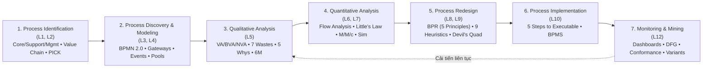

# 📚 Ôn Thi Quản Lý Quy Trình Nghiệp Vụ (BPM — Business Process Management)

> **Tài liệu tổng hợp & hệ thống hóa** từ toàn bộ 11 bài giảng (`Lecture 1 → 12`), 4 bộ Quiz + Đáp án (`Quiz 1, 3, 4, 5, 6`) và bài giải bảng trong [`Document/ref/`](./ref/).  
> Được tối ưu để **đọc nhanh, tự kiểm tra và tìm kiếm trực tiếp trên GitHub** (hỗ trợ Mermaid, LaTeX, `
` ẩn/hiện đáp án và bảng `.csv` có sẵn thanh tìm kiếm).

---

## 🗺️ 1. Bản đồ kiến thức theo Vòng đời BPM (BPM Lifecycle)

---

## 📂 2. Danh mục tài liệu ôn tập

| Tài liệu | Định dạng | Nội dung chính | Dùng khi nào? |
| :--- | :---: | :--- | :--- |
| **[01-Ly-Thuyet-Tong-Hop.md](./01-Ly-Thuyet-Tong-Hop.md)** | `.md` | Tóm tắt cô đọng toàn bộ **11 bài giảng (L1 → L12)** theo cấu trúc dễ nhớ, có bảng so sánh & sơ đồ Mermaid | Đọc nắm khung kiến thức toàn môn |
| **[02-Cong-Thuc-Va-Bai-Tap-Dinh-Luong.md](./02-Cong-Thuc-Va-Bai-Tap-Dinh-Luong.md)** | `.md` | Toàn bộ **công thức LaTeX** (Flow Analysis, CTE, Little's Law, M/M/1, M/M/c, Issue Impact) + **Lời giải chi tiết** bài tập slide & bảng | Ôn chắc phần tính toán (ăn điểm dễ nhất) |
| **[03-Ngan-Hang-Quiz-Va-Giai-Thich.md](./03-Ngan-Hang-Quiz-Va-Giai-Thich.md)** | `.md` | Toàn bộ **29 câu Quiz (Quiz 1, 3, 4, 5, 6)** có **ẩn/hiện đáp án**, giải thích chuẩn xác và vẽ lại **4 sơ đồ BPMN** bằng Mermaid | Tự test trước khi thi |
| **[quiz-bank.csv](./quiz-bank.csv)** | `.csv` | Bảng tra cứu 29 câu Quiz (Anh – Việt, đáp án, ghi nhớ nhanh) — **Search trực tiếp trên GitHub** | Tra nhanh 1 câu / từ khóa |
| **[flashcards.csv](./flashcards.csv)** | `.csv` | **55+ Flashcards** thuật ngữ, ký hiệu BPMN, 7 Wastes, 6M, BPR, Process Mining (có thể import vào Anki/Quizlet) | Học thuộc nhanh trước giờ G |
| **[redesign-heuristics.csv](./redesign-heuristics.csv)** | `.csv` | Ma trận **9 nhóm Heuristic tái thiết kế (H1–H9)** và tác động lên **Devil's Quadrangle (T/C/Q/F)** | Ôn nhanh Lecture 9 |

---

## ⚡ 3. Cheatsheet 1 phút — Những "Bẫy thi" hay gặp nhất

> [!IMPORTANT]
> **10 điểm cực dễ mất điểm trong đề trắc nghiệm BPM:**
> 1. **Task vs Event vs Condition (L1/L3):**
>    - **Task (Activity):** Bắt đầu bằng **động từ chủ động** (*Check..., Notify..., Calculate...*).
>    - **Event:** **Danh từ + phân từ quá khứ** (*Order received, Claim withdrawn, Payment expired*).
>    - **Condition:** Mệnh đề đúng/sai ở nhánh XOR (*Policy does not cover damage*).
> 2. **Ai chịu trách nhiệm trực tiếp khi quy trình kém hiệu quả? (L1)**  
>    → **Process Owner** (KHÔNG phải Process Participants, Executive Management, hay BPM Group).
> 3. **Implicit Gateways (L3):**
>    - 1 Task có **2 cung đi ra** = tương đương **AND-split** (không phải XOR!).
>    - 1 Task có **2 cung đi vào** = tương đương **XOR-join** (không phải AND!).
>    - **XOR-join** là cổng "ngây thơ" (dumb): nhận mỗi token từ bất kỳ nhánh vào nào đều đẩy thẳng ra ngoài.
> 4. **Pool vs Lane & Message Flow (L3):**
>    - **Pool** = tổ chức/thực thể độc lập (*Customer, Subcontractor*). **Lane** = phòng ban/vai trò/hệ thống nội bộ.
>    - **Sequence Flow** KHÔNG vượt qua ranh giới Pool (được vượt Lane).
>    - **Message Flow** CHỈ nối giữa 2 Pool khác nhau (KHÔNG nối 2 phần tử trong cùng 1 Pool).
> 5. **Data Object vs Data Store (L3):**
>    - **Data Object:** Tồn tại gắn với 1 instance quy trình (*Shopping cart, Invoice, Purchase history*).
>    - **Data Store:** Lưu trữ bền vững vượt ra ngoài vòng đời 1 instance (*CRM system, Product catalog, Database*).
> 6. **Event-Based Gateway & Boundary Events (L4):**
>    - Sau **Event-Based Gateway** chỉ được là **Intermediate Catching Event** hoặc **Receive Task** (KHÔNG được là Start Event hay Send Task).
>    - **Boundary Event** chỉ được là **Intermediate Catching Event** (Timer, Error, Message, Signal...) — KHÔNG dùng End Event.
> 7. **VA vs BVA vs NVA (L5):**
>    - **VA (Value-Adding):** Khách hàng sẵn sàng trả tiền (*Assess entitlement, Notify customer, Deliver goods*).
>    - **BVA (Business Value-Adding):** Cần cho doanh nghiệp quản trị/giảm rủi ro/tuân thủ (*Check stock, Match payment, Manager approval, Enter details into system*).
>    - **NVA (Non-Value-Adding):** Lãng phí cần loại bỏ (*Waiting, Handovers/Forwarding, Rework do lỗi nội bộ*).
> 8. **Sắp xếp ưu tiên vấn đề (L5):**  
>    → **Pareto Chart** và **Issue Register** (cùng PICK Chart). *Cause-effect / Why-why / VA Analysis* là để **phân tích**, không phải để xếp ưu tiên trực tiếp.
> 9. **Phân phối xác suất trong Simulation (L7):**
>    - Thời gian cố định/phần mềm → **Fixed**.
>    - Công việc lặp lại, ổn định → **Normal** (cần mean + std dev).
>    - Công việc phức tạp, đa số nhanh nhưng thỉnh thoảng rất lâu (**đuôi dài / long tail**) → **Exponential** (chỉ cần mean).
> 10. **Flow Analysis vs Arrival Rate (L6):**  
>     → Tính **Cycle Time** và **CTE** bằng Flow Analysis **KHÔNG cần biết Arrival Rate ($\lambda$)** (ví dụ: "2000 claims/year" là dữ kiện nhiễu khi tính CTE!). Nhưng tính **WIP** bằng Little's Law ($WIP = \lambda \cdot CT$) hoặc **Hàng đợi M/M/c** thì **BẮT BUỘC** cần $\lambda$.

---

## ⏱️ 4. Lộ trình ôn tập nhanh (60–90 phút)

1. **20 phút đầu:** Đọc lướt [01-Ly-Thuyet-Tong-Hop.md](./01-Ly-Thuyet-Tong-Hop.md) tập trung vào các bảng so sánh và quy tắc BPMN.
2. **20 phút tiếp theo:** Xem [02-Cong-Thuc-Va-Bai-Tap-Dinh-Luong.md](./02-Cong-Thuc-Va-Bai-Tap-Dinh-Luong.md) — tự bấm máy lại 4 công thức Flow Analysis, Little's Law và M/M/1.
3. **25 phút:** Tự làm toàn bộ 29 câu trong [03-Ngan-Hang-Quiz-Va-Giai-Thich.md](./03-Ngan-Hang-Quiz-Va-Giai-Thich.md) (không mở `
` trước khi chọn đáp án).
4. **10 phút cuối:** Lướt [flashcards.csv](./flashcards.csv) và [redesign-heuristics.csv](./redesign-heuristics.csv) để chốt lại các từ khóa dễ nhầm.
