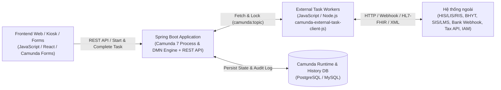

# Business Process Automation — Camunda BPMN 7 & DMN Blueprints

Kho lưu trữ thiết kế chuẩn **BPMN 2.0** và **DMN 1.3** cho **5 quy trình nghiệp vụ thực tế** (kèm phiên bản **As-Is** và **To-Be**), tối ưu cho nền tảng **Camunda Platform 7 (Spring Boot Embedded Engine + JavaScript External Task Workers / Frontend)**.

Toàn bộ tài liệu được thiết kế để:
- **Xem xét trực tiếp trên GitHub** qua biểu đồ **Mermaid** (`flowchart`, `sequenceDiagram`), bảng ánh xạ biến quy trình và đặc tả kỹ thuật.
- **Mở và chỉnh sửa trực tiếp bằng Camunda Modeler** (cấu hình sẵn `Camunda Platform 7.20.0`, `camunda:historyTimeToLive`, `camunda:topic`, `camunda:decisionRef`, `camunda:formKey`, `camunda:candidateGroups`).

---

## 1. Kiến trúc tổng thể (Camunda 7 + Spring Boot + JavaScript)

### Nguyên tắc thiết kế trên Camunda 7
1. **Tách biệt Luồng điều phối (BPMN) & Luật nghiệp vụ (DMN):** Mọi logic phân luồng, tính ngưỡng sai số, xếp lớp, phân quyền phê duyệt đều được tách ra `BusinessRuleTask` gọi file `.dmn` độc lập, tránh hard-code `if/else` trong Spring Boot hoặc JavaScript.
2. **External Task Pattern cho tích hợp hệ thống:** Các `ServiceTask` sử dụng `camunda:type="external"` và `camunda:topic="..."`, giúp worker viết bằng **JavaScript (Node.js)** hoặc **Spring Boot** có thể scale độc lập, tự động retry khi API bệnh viện/ngân hàng/thuế gián đoạn.
3. **Đối chiếu As-Is vs To-Be:**
   - **As-Is (`isExecutable="false"`):** Mô phỏng quy trình thủ công hiện tại để chỉ rõ các điểm nghẽn (nhập liệu trùng lặp, giấy tờ rời rạc, chờ duyệt không SLA).
   - **To-Be (`isExecutable="true"`):** Thiết kế chuẩn thực thi được trên Camunda 7 Engine với đầy đủ Events, Gateways, Sub-Processes và Boundary Events xử lý ngoại lệ.

---

## 2. Danh mục 5 quy trình nghiệp vụ

| # | Quy trình | Tài liệu GitHub | BPMN As-Is | BPMN To-Be | DMN Decision |
| :-: | --- | --- | --- | --- | --- |
| **01** | **Bệnh viện:** Tiếp nhận, Phân luồng Khám & Đối soát Bảo hiểm | [Đặc tả 01](./01-hospital-admission-triage-claim/README.md) | [as-is](./01-hospital-admission-triage-claim/bpmn/as-is-hospital-admission.bpmn) | [to-be](./01-hospital-admission-triage-claim/bpmn/to-be-hospital-admission.bpmn) | [triage-priority-routing.dmn](./01-hospital-admission-triage-claim/dmn/triage-priority-routing.dmn) |
| **02** | **Trường học:** Tuyển sinh, Kiểm tra đầu vào & Nhập học | [Đặc tả 02](./02-school-student-enrollment/README.md) | [as-is](./02-school-student-enrollment/bpmn/as-is-student-enrollment.bpmn) | [to-be](./02-school-student-enrollment/bpmn/to-be-student-enrollment.bpmn) | [class-level-placement.dmn](./02-school-student-enrollment/dmn/class-level-placement.dmn) |
| **03** | **Lớp học:** Điểm danh, Học bù & Đối soát Thù lao | [Đặc tả 03](./03-classroom-attendance-makeup-payroll/README.md) | [as-is](./03-classroom-attendance-makeup-payroll/bpmn/as-is-attendance-payroll.bpmn) | [to-be](./03-classroom-attendance-makeup-payroll/bpmn/to-be-attendance-payroll.bpmn) | [substitute-teacher-and-rate.dmn](./03-classroom-attendance-makeup-payroll/dmn/substitute-teacher-and-rate.dmn) |
| **04** | **Kế toán:** Xử lý Hóa đơn Đầu vào & Đối chiếu 3 bên | [Đặc tả 04](./04-accounting-invoice-3way-matching/README.md) | [as-is](./04-accounting-invoice-3way-matching/bpmn/as-is-invoice-matching.bpmn) | [to-be](./04-accounting-invoice-3way-matching/bpmn/to-be-invoice-matching.bpmn) | [invoice-matching-tolerance.dmn](./04-accounting-invoice-3way-matching/dmn/invoice-matching-tolerance.dmn) |
| **05** | **Quản trị nội bộ:** Phê duyệt Đa cấp & Cấp phát Tự động | [Đặc tả 05](./05-internal-multilevel-approval-provisioning/README.md) | [as-is](./05-internal-multilevel-approval-provisioning/bpmn/as-is-multilevel-approval.bpmn) | [to-be](./05-internal-multilevel-approval-provisioning/bpmn/to-be-multilevel-approval.bpmn) | [approval-routing-matrix.dmn](./05-internal-multilevel-approval-provisioning/dmn/approval-routing-matrix.dmn) |

---

## 3. Ma trận thành phần kỹ thuật Camunda 7

| Quy trình | Events (Kích hoạt & Chờ) | Gateways & DMN | Xử lý ngoại lệ & Tự động hóa |
| --- | --- | --- | --- |
| **01. Bệnh viện** | `MessageStartEvent` (`PatientCheckInReceived`) | `DMN` (`Decision_TriagePriority`), `ParallelGateway` (LIS + RIS + Tạm ứng) | `ErrorBoundaryEvent` (`ERR_INSURANCE_REJECTED`) |
| **02. Tuyển sinh** | `MessageStartEvent`, `EventBasedGateway` (Webhook ngân hàng vs `PT72H` Timer) | `DMN` (`Decision_ClassPlacement`), `ExclusiveGateway` (gia hạn 1 lần) | Expanded `SubProcess` (cấp mã SIS, tạo LMS, gửi welcome kit) |
| **03. Lớp học** | `EventBasedGateway`, `MessageCatchEvent` (Báo nghỉ / Điểm danh / Chọn lịch bù) | `DMN` DRD (`Decision_SubstituteEligibility` & `Decision_TeachingRate`) | `Multi-Instance SubProcess` (`${absentStudents}`), `TimerBoundaryEvent` (`PT48H` auto-lock) |
| **04. Hóa đơn 3 bên** | `MessageStartEvent` (`InvoiceEmailReceived`) | `DMN` (`Decision_InvoiceTolerance`), `ExclusiveGateway` (XML vs PDF, STP vs Exception) | **Straight-Through Processing (STP)** bỏ qua duyệt tay khi khớp ngưỡng |
| **05. Phê duyệt đa cấp** | `Non-Interrupting Timer` (`R/PT24H` nhắc duyệt), `Interrupting Timer` (`PT48H` leo thang) | `DMN` (`Decision_ApprovalMatrix`) | Sequential `Multi-Instance SubProcess` (`${approverList}`) + `completionCondition` |

---

## 4. Hướng dẫn mở & kiểm tra bằng Camunda Modeler

1. Cài đặt **Camunda Modeler 5.x** (khuyến nghị `>= 5.20.0`).
2. Mở bất kỳ file `.bpmn` hoặc `.dmn` nào trong các thư mục `01-*` đến `05-*`.
3. Kiểm tra góc dưới bên trái của Camunda Modeler hiển thị **Camunda Platform 7** (`7.20.0`).
4. Khi triển khai lên Spring Boot (`camunda-bpm-spring-boot-starter`), đặt toàn bộ file `to-be-*.bpmn` và `*.dmn` vào `src/main/resources/processes/` để Camunda Auto-Deployment tự nạp lúc khởi động.
